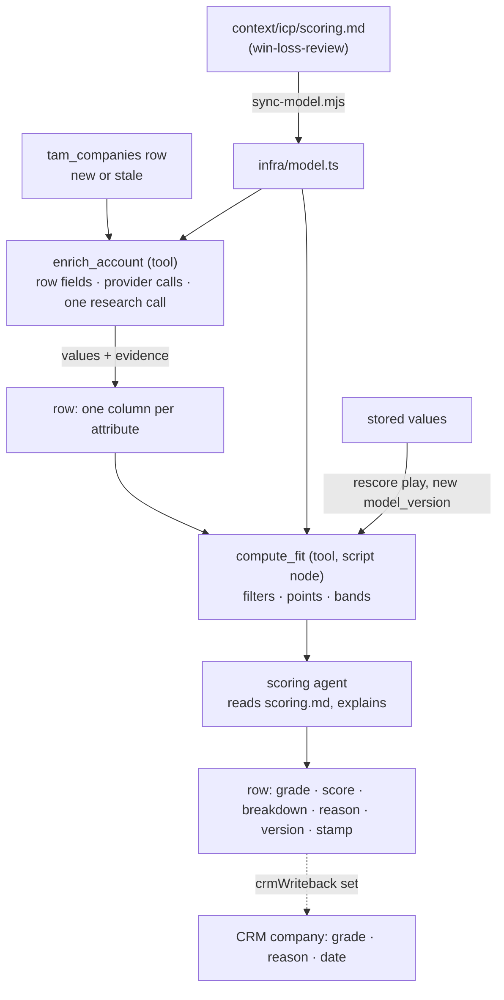

# Account scoring: grade every account with the model your best customers produced

Grade your market in two steps: enrich every company with exactly the attributes your fit model
names, then compute its grade in code and have an agent explain it. The model is
`context/icp/scoring.md`, which `win-loss-review`'s scoring pass writes from what separates your
best customers from your good ones. The grade lands on the Cargo row, and on the matching HubSpot or
Salesforce company when you name one in `infra/settings.ts`.

```sh
cargo-ai project add cookbook/account-scoring
```

1. **Model in.** `scripts/sync-model.mjs` reads the json block of `scoring.md`, checks it against
   [`references/scoring-format.md`](references/scoring-format.md), and writes `infra/model.ts`.
2. **Enriched.** `enrich_account` collects every attribute the model names: firmographics from the
   row, one provider call per provider attribute, one structured research call for the rest, each
   value with its evidence. A provider with no answer leaves the attribute unknown.
3. **Scored.** `compute_fit` applies the No Fit filters, the points and the bands in a script node;
   the scoring agent reads the model's reasoning and writes two sentences; `score_account` writes
   the grade, score, breakdown, reason, model version and stamp, and mirrors them to the CRM when
   asked. Four segments: Strong, Moderate, Weak, No Fit.

```ts
// infra/settings.ts
export const crmWriteback: CrmWriteback = {
  crm: "hubspot", // "none" | "hubspot" | "salesforce"
  matchOn: "domain", // or "id" on a CRM companies model
  matchProperty: "domain", // hs_object_id, or Id / your domain field on Salesforce
  fields: {
    grade: "cargo_fit_grade",
    reason: "cargo_fit_reason",
    scoredAt: "cargo_fit_scored_at",
  },
};
```

## How often, and how many

- **New and stale companies.** The scoring play runs hourly and takes only rows that enter its
  filter: never scored, or scored longer ago than `rescoreAfter` (`"6 months"` by default). The
  rows already in the model are graded by one backfill batch, priced on a ten-row pilot first
  ([references/run.md](references/run.md)).
- **A new model.** The rescore play regrades every enriched row graded with an older
  `model_version`, from the values already stored: no provider call, no research. It ships
  disabled and runs as a batch after a ten-row pilot.

## Score a CSV of companies once

"Which companies in this CSV are worth it?" is a one-time answer, not a pipeline: this cookbook
scores a model, not a file. Use the one-off [`score-leads`](../score-leads/SKILL.md) skill
(`npx skills add getcargohq/gtm-skills/score-leads`). Install this cookbook when the same market
should stay graded.

## How it works



## Why two steps

Collecting data and deciding a grade fail in different ways, so they are built differently. The
data a model needs is known before the first call, so step 1 is a tool with fixed calls: every
company gets the same evidence, and the cost per company is predictable. The grade must not move
between two runs on the same values, so step 2 is code; an agent explains it and cannot change it.
Kept apart, a model change costs only step 2, and the values collected in step 1 serve reps and
other agents as well as the grade.

## Why the model is synced, not read at run time

The grade is computed by a script node, and the model is bundled into that node at deploy. Every
company scored after one deploy is scored by the same version, the plan shows what a model change
does before it ships, and the contract fails when the synced copy and `scoring.md` disagree. The
scoring agent still reads `scoring.md` from the context, for the reasoning behind each attribute.

## Placeholders (edit before deploy)

1. **`languageModel`** on the scoring agent.
2. **`dataTeamKeywords`** in `infra/tools/enrich-account.ts`, or whatever your provider attributes
   need; the example model's one provider attribute counts people in data roles.
3. **`context/scoring.md`** is an example. Yours is `context/icp/scoring.md`.

## What it does not do

It does not decide what a good account is (`win-loss-review` does, from your deals), let an agent
set or adjust a grade, search the web from the scoring agent, create CRM records, write a CRM field
you did not name, or grade a company whose model attribute has no producer: the contract fails
first.

## Verify

From this skill's folder:

```sh
node --import tsx evals/contract.mjs
```

From the project root:

```sh
npm run check && cargo-ai project plan
```
