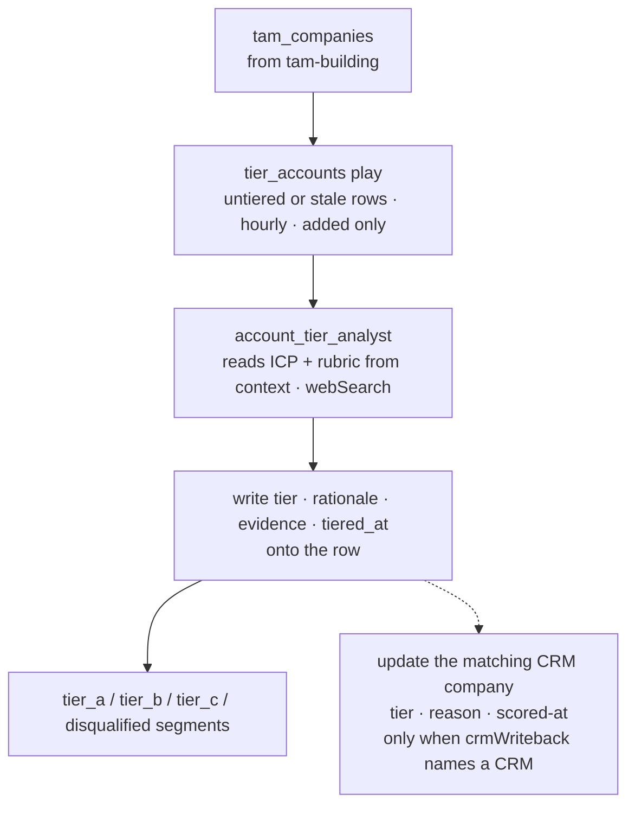

# Account scoring: score every account against your ICP, on a schedule

Score accounts against your ICP in three steps: get the accounts into a Cargo
model, tier each one with an agent that reads your rubric, and write the tier
back where reps work. This cookbook deploys all three: the write lands on the
Cargo row, and on the matching HubSpot or Salesforce company when you name one
in `infra/settings.ts`.

```sh
cargo-ai project add cookbook/account-scoring
```

1. **Accounts in.** The play reads a Cargo companies model: `tam_companies`,
   which tam-building syncs, or your CRM's companies model: any model with an
   id, a name and a domain, its columns mapped into the workflow input.
2. **Scored.** An agent tiers each row A, B, C or disqualified against the ICP
   and `tiering-rubric.md` in your workspace context, with a two-sentence reason
   and the page that decided it.
3. **Scores out.** The tier, reason, evidence URL and a `tiered_at` stamp are
   written onto the row and land in four segments. Set `crmWriteback` in
   `infra/settings.ts` and the same run then updates the matching CRM company
   (by domain, or by record id when the play runs on a CRM model) with tier,
   reason and scored-at, in three properties you create and name. It updates,
   never creates, and writes no other field. The default is `none`.

```ts
// infra/settings.ts
export const crmWriteback: CrmWriteback = {
  crm: "hubspot", // "none" | "hubspot" | "salesforce"
  matchOn: "domain", // or "id" on a CRM companies model
  matchProperty: "domain", // hs_object_id, or Id / your domain field on Salesforce
  fields: {
    tier: "cargo_tier",
    reason: "cargo_tier_reason",
    scoredAt: "cargo_tiered_at",
  },
};
```

## How often, and how many

- **Schedule.** The play runs hourly and tiers only rows that enter its filter:
  never tiered, or tiered longer ago than `rescoreAfter` in
  `infra/settings.ts`. It is `"6 months"` by default; `"7 days"` re-scores the
  whole book weekly, and re-bills every account each week. The value is
  `<n> days`, `<n> months` or `<n> years`; write a week as `7 days`.
- **Volume.** The accounts already in the model are tiered by one backfill
  batch ([references/run.md](references/run.md)); after that, only new and
  stale rows. Cost is one agent run per company, so 100,000 accounts is 100,000
  agent runs on the backfill. Pilot ten rows first and multiply:

```sh
cargo-ai orchestration batch create --workflow-uuid <tierAccountWorkflowUuid> \
  --data '{"kind":"filter","modelUuid":"<tamCompaniesUuid>","limit":10}' \
  --wait-until-finished
```

## Score a CSV of companies once

"Which companies in this CSV are worth it?" is a one-time answer, not a
pipeline: this cookbook scores a model, not a file. Use the one-off
[`score-leads`](../score-leads/SKILL.md) skill
(`npx skills add getcargohq/gtm-skills/score-leads`), which asks for your ICP
criteria, enriches each domain in the CSV and returns a score, reason and tier
per row. Install this cookbook when the same list should stay scored.

## What it does

- **Judges against your own rubric.** The ICP and `tiering-rubric.md` live in
  the context repo. Edit the rubric and the next tier changes, with no deploy.
- **Looks up only what the row does not hold.** Firmographics were settled by
  tam-building's filter. The agent searches once, to settle the doubt that
  would change the tier, and records the page.
- **Writes a reason a rep can argue with.** Every tier carries two sentences
  naming the rubric lines that decided it, the evidence URL, and a stamp.
- **Hands downstream work four segments.** `tier_a_accounts` is what contact
  sourcing and engagement run on; `disqualified_accounts` is what they
  suppress.
- **Runs without a CRM, writes to one when you name it.** It tiers
  `tam_companies` in Cargo by default; `crmWriteback` adds the CRM update
  described above.

## How it works



| File                                     | Resource           | Role                                                          |
| ---------------------------------------- | ------------------ | ------------------------------------------------------------- |
| `infra/models/tam-companies.ts`          | `defineModel`      | a copy of tam-building's model, plus the four tier columns    |
| `infra/agents/tier-analyst.ts`           | `defineAgent`      | the judgment: context and webSearch, no write access          |
| `infra/plays/tier-accounts.ts`           | `definePlay`       | the writes, and the eligibility filter on `tiered_at`         |
| `infra/settings.ts`                      | (not a resource)   | `rescoreAfter` and `crmWriteback`, the two settings           |
| `infra/connectors/crm.ts`                | `defineConnector`  | the CRM, bound; declared only when `crmWriteback` names one   |
| `infra/segments/tiers.ts`                | `defineSegment` ×4 | one per tier the agent can emit                               |
| `infra/connectors/anthropic.ts`          | `defineConnector`  | the LLM, bound                                                |
| `infra/connectors/ai-ark.ts`             | `defineConnector`  | the model copy's source; dropped when tam-building is present |
| `infra/folders/index.ts`                 | `defineFolder` ×3  | models, agents and plays, named after the skill               |
| this skill's `context/tiering-rubric.md` | (not a resource)   | example rubric to copy into the project's `context/`          |

## Placeholders (edit before deploy)

1. **The rubric**: copy `context/tiering-rubric.md` into the project's
   `context/` beside the ICP, and rewrite every tier for your business.
2. **The model**: when tam-building is installed, move the four
   `additionalColumns` onto its `tam_companies` and delete this copy.
3. **`languageModel`** in `infra/agents/tier-analyst.ts`.
4. **`infra/settings.ts`**: `rescoreAfter`, and `crmWriteback` if the tier
   should reach the CRM.

## Cost

One agent run per company, in LLM tokens plus any web searches, capped by
`maxSteps`. The pilot measures it on ten rows before the backfill is approved.
After that the play only tiers what arrives and what goes stale.

## Verification

```sh
node --import tsx evals/contract.mjs   # the graph boundaries, from the compiled registry
cargo-ai project types && cargo-ai project check && cargo-ai project plan
```

`evals/acceptance.md` is the line-by-line acceptance test.

## Composes into

`contact-sourcing` on tier A, `agentic-engagement`, `new-hire-detection`.
Works best after `tam-building`.
