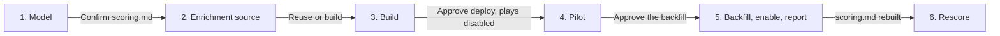

# Account scoring

**State: to-be-approved.** Deploy-verified against a live workspace: not yet. Version 1.0 replaced
the approved agent-judged tiering with the two steps below; treat `Done when` as the acceptance test
and review `cargo-ai project plan` before deploying. Make no outcome claim for this skill until it is
approved again.

## The outcome

Every company in your market graded Strong, Moderate, Weak or No Fit by the model your own deals
produced, with a score out of 100, the breakdown that produced it, and two sentences a rep can act
on, written on the row and, when you choose, on the matching CRM company. New companies are graded
as they land. When the model changes, the whole book is regraded from the values already collected,
without paying for them again.

**The model is `context/icp/scoring.md`.** `win-loss-review`'s scoring pass writes it from what
separates your best customers from your good ones; a company with no closed deals writes it by hand
in the same shape and marks it a hypothesis. Its json block says, for every attribute, what to
collect and how, then how to score it. `scripts/sync-model.mjs` turns that block into
`infra/model.ts`, and the contract fails when the two differ.

**Two steps, kept apart on purpose:**

1. **Enrich: a tool, not an agent.** The model already says which values are needed and where each
   comes from, so the path is fixed: firmographics from the row, one provider call per provider
   attribute, and one structured research call that answers every research attribute with a label
   from its allowed list and the page that shows it. Every company gets the same calls, so two
   grades are comparable, and the cost per company is fixed. A provider with no answer leaves the
   attribute unknown, which the model scores as neutral. The values land on the row, one column
   each, where reps, the cockpit and other agents can read them.
2. **Score: code computes, the agent explains.** A script node holding the model applies the No Fit
   filters, then the points, the total and the band. The scoring agent reads the model's reasoning
   from the context and writes two sentences naming what decided the grade; its answer reaches the
   reason column and nothing else. On the same stored inputs, a language model scoring a rubric
   changed the tier of 23 of 100 companies between two runs. Code does not.

**Ask before you build step 1.** Many workspaces already standardize company enrichment (an
enrichment tool, a model that already holds the fields, crm-enrichment). Reuse what exists for the
attributes it covers and build only the rest.

**Two failure modes worth knowing before you start.** Writing a custom column with its `custom__`
read-side name drops the value while the node reports success, so the play runs perfectly over a
book with no grades in it. And a play enabled without a backfill never grades the rows that were
already there: `changeKinds: ["added"]` only enrols rows that arrive after it is on.

## Example

> Grade every company in our TAM with the scoring model from our win-loss review, and keep new ones graded as they land.

Illustrative output, fictional records:

| Company (domain)              | Grade    | Score | Reason (written on the row)                                                                                                                                    |
| ----------------------------- | -------- | ----- | -------------------------------------------------------------------------------------------------------------------------------------------------------------- |
| Northwind (northwind.example) | Strong   | 85    | A marketplace with a 26-person data team and live in-session personalization: the three attributes that separate our best customers. Its warehouse is unknown. |
| Globex (globex.example)       | Moderate | 52    | A consumer subscription with native apps on both stores, but a data team of five: the attribute that weighs most is the one it lacks.                          |
| Initech (initech.example)     | No Fit   | 61    | An agency: we never target agencies, whatever else it scores.                                                                                                  |

The row also carries every attribute value with its evidence, the breakdown (`People in data roles:
26 (35 of 35) · Business model: marketplace (30 of 30) · …`), the model version and the stamp. With
`crmWriteback` set to HubSpot, `northwind.example`'s company gets the grade, the reason and the date.

## Guide the operator through every phase



Every substantive message starts with the current phase and ends with a `Next step` section giving
the operator one concrete decision, what it unlocks, and what stays blocked. During an in-progress
operation, say `No action needed` and name the next checkpoint. Never end with a generic offer to
help.

1. **Model.** Read `context/icp/scoring.md` from the project. None? Stop and send the operator to
   win-loss-review's scoring pass; with no closed deals to learn from, write it by hand in the shape
   of [`references/scoring-format.md`](references/scoring-format.md) and mark it a hypothesis. Run
   `node scripts/account-scoring/sync-model.mjs`: it refuses a block that breaks the format. Show
   the attributes and how each is collected, and ask the operator to confirm. Nothing bills.
2. **Enrichment source.** Look first: the workspace's tools (`cargo-ai orchestration tool list`),
   its models and their columns (`cargo-ai storage model list`), crm-enrichment under `infra/`. Then
   ask, with what you found:
   "Do you already have something that standardizes the enrichment of any company? We found X; it
   covers these attributes." All covered: reuse it and map its fields. Some: reuse it and build only
   the missing attributes. None: build the tool below. Nothing bills.
3. **Build.** Reconcile, adapt, run the contract, types, check and plan, and show the plan: the
   columns added to `tam_companies`, the three tools, the agent, both plays **disabled**, and the
   four segments. End by asking to deploy with the plays disabled. A deploy grades nothing.
4. **Pilot.** Ten rows through the scoring play's workflow as a batch
   ([`references/run.md`](references/run.md#pilot)). Read every value against its evidence for
   three of them, check one grade of each kind by hand, give the coverage per attribute, the
   evaluator results, and the observed cost per company with what the whole book would cost. End by
   asking to approve the backfill at that cost and to enable the scoring play.
5. **Backfill, enable, report.** Backfill every ungraded row, enable the scoring play, and report
   the grade distribution, the No Fit share, coverage per attribute, actual credits and a direct
   Cargo link to each segment. Recommend one next step.
6. **Rescore.** Every rebuild of `scoring.md` lands here. Re-sync, plan, deploy. Same attributes:
   pilot ten rows through the rescore play, then batch the rest, with no enrichment cost. A new
   attribute: wire it in step 1 if it is a provider attribute, then run the scoring play's workflow
   over the book, priced on ten rows first.

## Put it in your project

This folder is a **worked example**: real project resources written for some other company. The job
is to end up with the code your company would have written, in your project, and an agent does the
adapting.

**Install the required authoring skill first.** If `cargo-project` is absent, run:

```sh
npx skills add getcargohq/cargo-skills --skill cargo-project
```

Then read `.agents/skills/cargo-project/SKILL.md` directly; no session reload is needed. Complete its
bootstrap and use its authoring, state, plan, and deployment rules throughout. Stop before any
template work if the skill cannot be installed or read.

1. **Install it: the CLI does the copy.** From inside the project (the folder holding `cargo.json`),
   `cargo-ai project add cookbook/account-scoring` writes this example to `infra/account-scoring/`,
   its script to `scripts/account-scoring/`, and this procedure to `.agents/skills/account-scoring/`.
   No project yet?
   `cargo-ai project init <dir> --cookbook account-scoring && cd <dir> && npm install` does both.
   **If you are reading this from the project's `.claude/skills/`, the install already happened:
   start at step 2.**
2. **Sync the model.** `node scripts/account-scoring/sync-model.mjs` reads
   `context/icp/scoring.md` and writes `infra/account-scoring/model.ts`. It fails on a block that
   breaks [`references/scoring-format.md`](references/scoring-format.md); fix the block, never the
   generated file.
3. **Reconcile it with what is already declared.** This example carries a copy of `tam_companies`
   and its AI Ark connector so it deploys on its own. When `infra/tam-building/` exists, move the
   `additionalColumns` from the copy onto tam-building's model, point the plays, the tools and the
   segments at that export, and delete the copy and its connector: one slug declared twice collides
   at deploy. Reuse existing Anthropic, LinkedIn and Linkup connectors the same way. A deploy drops
   any custom column the model declaration no longer lists, values included, so first compare the
   declaration with `cargo-ai storage column list` on the live model and carry over every
   `custom__` column you want to keep, including the old `tier` columns if version 0 ran here. This
   skill declares no `defineContext`: that resource is a per-workspace singleton the project owns.
4. **Wire step 1 to your model.** Phase 2 above decides what is reused. Then, in
   `infra/account-scoring/tools/enrich-account.ts`: one connector call per provider attribute,
   passed to `assembleProfile` under the attribute's slug; in `settings.ts`, the column of every
   firmographic attribute, added to `accountInput` and to the scoring play's call. Research
   attributes need no edit: the question and its schema are built from the model.
5. **Adapt and deploy disabled.** Work the sections below in order: _What should not change_ is
   what you argue back about (say what breaks, then do it if they still want it); _What you can
   change_ is what you offer unprompted; _What you will be asked_ is the floor, and you derive
   before you ask. Record what you changed and why under a `## Decisions` section in your copy of
   this file. Then run `SCORING_MD=context/icp/scoring.md node --import tsx evals/contract.mjs` from
   this skill's folder, followed by
   `cargo-ai project types && cargo-ai project check && cargo-ai project plan` from the project
   root. Show the diff, and deploy only on a yes. Never run `cargo-ai project init --force` in a
   non-empty directory.
6. **Pilot, backfill, verify.** Follow [`references/run.md`](references/run.md), then walk _Done
   when_ line by line with evidence. Deployed cleanly and graded nothing is the normal failure.

## What you will be asked

**Derive before you ask.** An input with a lookup is looked up, not asked.

| Input                 | Kind    | How it is answered                                                                                                                                                                                          | Why it matters                                                                                                                   |
| --------------------- | ------- | ----------------------------------------------------------------------------------------------------------------------------------------------------------------------------------------------------------- | -------------------------------------------------------------------------------------------------------------------------------- |
| `scoring.md`          | derived | Read `context/icp/scoring.md`. None? Stop: win-loss-review's scoring pass writes it, or the operator writes it by hand as a hypothesis                                                                      | Every grade comes from it. A grade with no model behind it is the guess this skill exists to replace                             |
| existing enrichment   | asked   | Look first (tools, models with enriched columns, crm-enrichment), then ask with what you found: "Do you already have something that standardizes the enrichment of any company?"                            | Rebuilding enrichment a workspace already runs doubles the bill and splits the values across two places that will disagree       |
| `firmographicColumns` | derived | The scored model's columns (`cargo-ai storage column list`) matched to the model's firmographic attributes, in `settings.ts`                                                                                | A firmographic read from the row is free; one left unmapped is unknown on every company                                          |
| provider wiring       | derived | One connector action per provider attribute, from the attribute's `get.how`; its connection from `cargo-ai connection connector list`. Asked only when two providers could serve it and their prices differ | The contract fails on a provider attribute nobody wired, instead of every company scoring "unknown" on it in silence             |
| `model`               | derived | `tam_companies` from tam-building. Another companies model works if it has an id, a name and a domain; map its columns into `accountInput`                                                                  | The enrichment reads the row through these columns. A renamed one is an unknown on every company                                 |
| `languageModel`       | derived | Whichever LLM connector the workspace already holds (`cargo-ai connection connector list`)                                                                                                                  | It writes the reason, never the grade, so a smaller model is fine                                                                |
| `rescoreAfter`        | derived | `"6 months"` in `infra/settings.ts`. Ask only to change it                                                                                                                                                  | How often a graded company is enriched again. Shorter re-bills the whole book more often; a new model version never waits for it |
| `crmWriteback`        | asked   | `none` unless the grade should reach a CRM. Then the connected CRM (`cargo-ai connection connector list`) and the three property names the operator created                                                 | Reps read the CRM, not the Cargo row. A property that does not exist is a write that ends green and lands nothing                |

Checked before moving on, not after the deploy:

- `scoring.md` passes `sync-model.mjs`, and `infra/model.ts` was regenerated from it
- the contract passes against the project's `scoring.md`: every attribute has a producer
- `model`: the column names in `accountInput` match `cargo-ai storage column list` on the live model
- `crmWriteback`: the three properties exist on the CRM company object, and the match property holds
  the same value as the row: a bare domain, or the record id when the play runs on a CRM model

## What you can change

The code is a worked example. These reshapes are expected, and the agent offers them rather than
waiting to be asked. Every one costs something; that is what makes it a variation and not the
default.

| Variation                 | When it is right                                                                                                     | How                                                                                                                                                                                                                                                 | What it costs                                                                                                                                                                            |
| ------------------------- | -------------------------------------------------------------------------------------------------------------------- | --------------------------------------------------------------------------------------------------------------------------------------------------------------------------------------------------------------------------------------------------- | ---------------------------------------------------------------------------------------------------------------------------------------------------------------------------------------- |
| `reuse-enrichment`        | The workspace already enriches companies into a model that holds some of the attributes                              | Read those fields instead of calling for them: map them like firmographic columns, and keep provider calls and research only for what the existing enrichment lacks                                                                                 | The grade now depends on another pipeline's freshness and definitions. Check its values against two companies you know before the pilot                                                  |
| `crm-writeback`           | Reps work in HubSpot or Salesforce and the grade should be visible there                                             | Set `crmWriteback` in `infra/settings.ts`: the CRM, `matchOn` (`domain`, or `id` when the plays run on a CRM companies model), the match property, and the three field names                                                                        | A CRM connection and three CRM properties to maintain. A miss ends the run green, so the pilot reads one CRM record back. A domain shared by duplicate CRM companies grades none of them |
| `crm-accounts`            | The accounts already live in a CRM rather than in tam_companies                                                      | Point the plays, the tools' writes and the segments at a CRM companies model carrying the added columns, map its columns into `accountInput`, and set `matchOn: "id"`                                                                               | The CRM's own fields decide what the firmographic attributes read. A thin CRM record means more unknowns                                                                                 |
| `faster-refresh`          | The market moves fast enough that six-month-old values are wrong                                                     | `rescoreAfter: "30 days"` (or `"7 days"`) in `infra/settings.ts`                                                                                                                                                                                    | Every account is enriched, and billed, once per window instead of twice a year                                                                                                           |
| `deep-research`           | Research attributes come back unknown on most companies at standard depth                                            | Set the research call's `depth` to `"deep"` in `tools/enrich-account.ts`                                                                                                                                                                            | Slower runs and a higher price per research call on every company; measure the coverage gain on the pilot first                                                                          |
| `expensive-provider-gate` | One provider attribute costs much more than the rest                                                                 | Call it only when the cheaper attributes already place the company at Moderate or above: compute once without it, branch on the grade, then enrich and score again                                                                                  | Two compute passes and a branch to maintain, and the gated attribute is unknown on every company below the gate                                                                          |
| `unified-account`         | Other pipelines (a rep cockpit, routing) read accounts from Unify Accounts and should find the grade on the same row | Declare Unify Accounts (`unifyAccounts`, once per project) with the added columns, run the plays over it filtered to rows whose `ai_ark___tam_companies___id` is set, read the company facts from those columns, and write onto the unified account | Unify Accounts is shared by every pipeline: its `additionalColumns` list is authoritative, so copy the live columns in first                                                             |

## What should not change

However far you adapt, these hold. Ask for one anyway and the agent tells you what breaks, then does
it if you still want it, and records why under `## Decisions` in your copy of this file.

- **The model lives in the context; the resources hold a synced copy.** (`context/icp/scoring.md`,
  `infra/model.ts`) Edit the generated file and the model reps read is no longer the one that
  grades; the contract fails when they differ.
- **Code computes the grade.** (`tools/compute-fit.ts`, `compute/fit.ts`) Let an agent set or adjust
  it and the same company changes grade between runs, and the cut-offs stop meaning what the model
  says.
- **The agent explains and writes nothing.** (`agents/scoring-agent.ts`, `tools/score-account.ts`)
  The write takes the grade from `compute_fit`'s output and only the reason from the agent. No
  search: it may only say what the grade was computed from.
- **Step 1 is a tool with fixed calls, and it writes nothing.** (`tools/enrich-account.ts`) An agent
  gathering data grades every company on different evidence; a tool that writes hides failed
  enrichments behind partial rows.
- **Every attribute has a producer.** (`evals/contract.mjs`) A provider attribute nobody wired is
  unknown on every company, and unknown is neutral, so nothing looks wrong.
- **Unknown is neutral, and a filter never fires on it.** (`compute/fit.ts`) A provider with no
  coverage is not evidence against a company; scored as a no, it buries every account with a thin
  public footprint.
- **The research question never carries a weight.** (`research.ts`) A researcher that knows which
  answer scores best finds that answer.
- **Custom columns are written with their bare slugs.** (`compute/fit.ts`, `tools/score-account.ts`)
  `custom__fit_grade` on the write becomes `custom.custom__fit_grade`, the node reports "Record
  upserted", and the value is dropped.
- **Eligibility is the stamp, not the grade.** (`plays/score-accounts.ts`) Filter on `scored_at`
  being null or stale. Filter on the grade and a failed run looks the same as a legitimate No Fit.
- **A grade ships with its reason, its model version and its stamp, on the same write.**
  (`tools/score-account.ts`) A grade nobody can audit is a number a rep will not trust, and one with
  no stamp is graded again on every tick.
- **`changeKinds: ["added"]` stays, and both plays ship disabled.** (`plays/`) Runs are created for
  rows entering the filter; without it the bill scales with how often the cron fires. Disabled is
  what makes the pilot happen before the book is billed.
- **The CRM write-back updates, never creates, and fails on multiple matches.**
  (`tools/score-account.ts`) `upsertRecords` would create a CRM company for every TAM row; a domain
  matching two CRM companies writes to neither, and the node's error names the count.
- **Every grade the code can compute has a segment.** (`segments/grades.ts`) A grade with no segment
  is a row that lands nowhere and quietly disappears from the book.

## Done when

- `context/icp/scoring.md` was confirmed by the operator, and `infra/model.ts` was synced from it
- the existing-enrichment question was asked with what the workspace holds, and the answer is
  recorded under `## Decisions`
- the contract passes against the project's `scoring.md`
- the pilot graded ten rows; three were read value by value against their evidence, and one grade of
  each kind present was checked by hand
- the pilot reported coverage per attribute and the observed cost per company
- every row in the model carries a grade, a score, a breakdown, a reason, a model version and a
  `scored_at` stamp, and no row carries one without the others
- the four segments resolve, and their counts sum to the graded row count
- the agent's evaluator pass rate is at or above its threshold
- with `crmWriteback` set, one piloted company read back from the CRM carries the same grade, reason
  and scored-at date as its row
- after a model change, the rescore regraded every enriched row with no provider call
- the report gave the grade distribution, coverage, actual credits against the pilot's estimate, and
  one recommended next step

## What it costs

**Step 1 is the cost.** Per company: one call per provider attribute, one structured research call,
and nothing for firmographics read from the row. The pilot measures it: read actual credits for the
ten rows, then multiply by the ungraded row count before approving the backfill. Reusing an
existing enrichment cuts it attribute by attribute.

**Step 2 is cheap.** `compute_fit` is a script node: no model call, no credits. The scoring agent is
one short model run per company, billed as LLM tokens through the bound connector; it reads the
context and answers, with no search.

After the backfill, the scoring play only grades what arrives and what goes stale after
`rescoreAfter`, so the steady-state cost follows how many companies tam-building lands and how long
that window is. A model change costs one agent run per enriched company and no enrichment. The CRM
write-back is one connector action per graded company; the pilot's actual credits include it.

## Composes into

`win-loss-review` (its scoring pass writes the model this applies, and hands off here every time it
rebuilds it), `contact-sourcing` (the buyers at every Strong account), `agentic-engagement` (talk to
the accounts this ranked), `new-hire-detection` (watch Strong accounts for the hires that move a
grade), `readiness-scoring` (the timing next to the fit: route only Strong accounts whose signals say
now). Works best after `tam-building`, whose `tam_companies` it grades.
