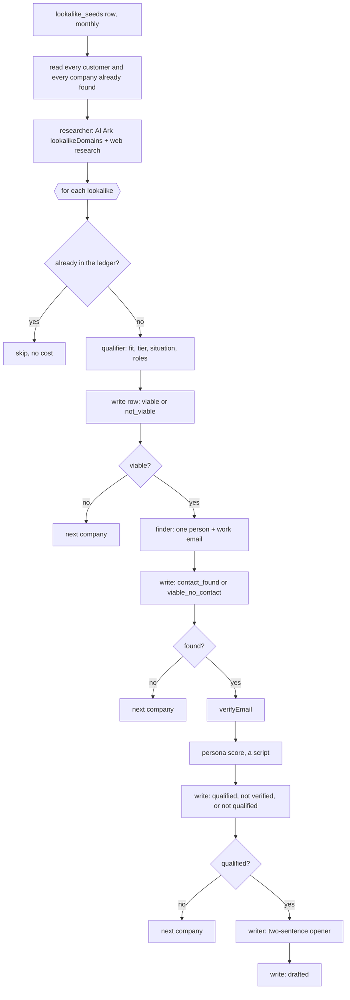

# Customer lookalikes: the next accounts, shaped like the customers you already won

To keep a steady supply of accounts worth a first email, start from the customers you already have:
each month, find the companies that look like each customer did when they bought, judge them against
your own rubric, find the one person to write to, verify their email, and draft the two sentences
that only that person could receive. Every company is written down with the verdict it reached, so
nothing is judged or paid for twice.

```sh
cargo-ai project add cookbook/customer-lookalikes
```

It is a lookalike play built alongside the reply loop in `reply-handling`, with that company's
customers, scoring model and people taken out. The original sent each draft to an internal inbox for
review; here the pipeline ends at the row, and sending is a variation.

## What it does

- **Seeds from customers, at purchase.** `lookalike_seeds` holds one row per customer, written by a
  person: what they bought, why, who signed, and what they looked like when they signed.
- **Researches lookalikes.** An AI Ark lookalike search on the customer's domain, confirmed and
  ranked with web research against the rubric, excluding every customer and every company already
  found.
- **Judges each one, cheapest first.** Account fit, tier and situation against the rubric; then the
  one person to write to, aimed at the function nobody owns; then a verified email; then a persona
  score.
- **Drafts only for the qualified.** Two sentences and a subject, from what is happening at the
  company and the gap, for a sequence or `reply-handling` to send.
- **Keeps a ledger.** `lookalike_prospects`, one row per company with the verdict of the gate it
  stopped at.

## How it works



| File                                         | Resource          | Role                                                                    |
| -------------------------------------------- | ----------------- | ----------------------------------------------------------------------- |
| `infra/models/lookalike-seeds.ts`            | `defineModel`     | one row per customer to find more of, written by a person               |
| `infra/models/lookalike-prospects.ts`        | `defineModel`     | one row per lookalike, with its verdict; the exclusion list             |
| `infra/agents/lookalike-researcher.ts`       | `defineAgent`     | lookalikes of one customer at purchase; AI Ark and web search           |
| `infra/agents/account-qualifier.ts`          | `defineAgent`     | fit, tier, situation and the roles gap, against the rubric              |
| `infra/agents/contact-finder.ts`             | `defineAgent`     | the one person to write to and their work email; AI Ark                 |
| `infra/agents/opener-writer.ts`              | `defineAgent`     | two sentences and a subject, for qualified people only                  |
| `infra/plays/find-lookalikes.ts`             | `definePlay`      | the monthly run over every seed, shipped disabled                       |
| `infra/scripts/lookalikes/*.ts`              | (script nodes)    | the account gate, the contact gate and the persona score                |
| `infra/settings.ts`                          | (not a resource)  | lookalikes per customer, the gate floors, the persona points            |
| `infra/connectors/*.ts`                      | `defineConnector` | Anthropic, AI Ark and email verification, bound to the defaults         |
| `infra/folders/index.ts`                     | `defineFolder`    | one folder per kind, named after the skill                              |
| `context/lookalike-rubric.md`                | (context file)    | the example rubric for the project's context repo                       |

## Why it is built this way

**Seeds carry the moment of purchase.** A lookalike search on a domain returns companies that look
like the customer now. The customer you want more of is the one that signed, at the size, stage and
trigger it had then, and only a person can write that down.

**The ledger is the exclusion list.** Every company the research returns is written with a verdict,
including the rejects, so next month's research is told what never to return and the loop skips
anything already judged. Without that, a monthly pipeline is a monthly bill for the same five
companies.

**Cheapest gate first.** The account score uses free role counts and one firmographic lookup; the
people search bills per person and the enrichment per email found, so they run only past the account
gate, and the writer only for a person who qualified.

**The persona score is a script.** Persona tier, a verified email and time in seat add up to a
number; an agent paid to do that addition can also get it wrong. The points live in
`infra/settings.ts`.

**Verdict first, then the guard.** Each stage writes its verdict and then tests a bare `continue`.
The workflow parser in @cargo-ai/cdk 1.0.119 empties a guard block that ends in `continue`, so
`if (stop) { model.upsert(…); continue; }` compiles to a skip with no write.

## Placeholders (edit before deploy)

1. **Lookalike rubric**: `context/lookalike-rubric.md`, rewritten for your company in the project's
   context repo.
2. **Seed rows**: one per customer, in `lookalike_seeds` after the deploy.
3. **Floors and persona points**: `infra/settings.ts`.
4. **Language model**: `languageModel` on the four agents.

## What it does not do

It does not send anything, write to a CRM, or watch the market for new companies on its own: every
lookalike starts from a customer someone chose. Sending is `reply-handling` or your sequencer; the
whole market is `tam-building`.
