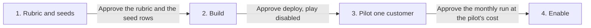

# Customer lookalikes

**State: to-be-approved.** Deploy-verified against a live workspace: not yet. Treat `Done when`
below as the acceptance test and review `cargo-ai project plan` before deploying. Make no outcome claim
for this skill until it is approved.

## The outcome

On the first of every month, each customer you chose as a seed yields up to five companies that
look like that customer did when they bought, each one judged and written down: the account
score, what is happening there now, the function nobody owns, the one person to write to with a
verified email, and two sentences that only that person could receive. A rep opens the ledger and
starts from the rows marked `drafted`.

It runs on a small model you fill by hand, `lookalike_seeds`: one row per customer worth finding
more of, with what they bought, why, who signed, and their shape at purchase. That last part is
the point. A lookalike search on a domain alone returns companies that look like the customer
today; the seed row is what lets the research match the company they were when they signed.

Every company the research returns passes four gates, cheapest first, and stops at the first one
it fails:

1. **Account.** An agent scores it against your lookalike rubric in the workspace context: fit,
   tier, what is happening now (with dates and sources), and which of the functions you sell to
   have no owner. The floors in `infra/settings.ts` decide.
2. **A person.** An agent finds the one person to write to, aimed at the function nobody owns,
   and their work email.
3. **A verified email.** Cargo's verifier checks the address. Anything but `valid` stops here.
4. **A persona score.** Arithmetic, not judgement: persona tier, the verified email, how recently
   they took the seat. Only then does a writer spend a call on the opener.

Each stage writes its verdict onto the company's row before it can stop, so the ledger always says
how far a company got, and next month's research excludes everything already judged.

**Two failure modes worth knowing before you start.** Without the exclusions the same five
lookalikes come back every month and each one is scored, searched and enriched again, so the
pipeline pays monthly for nothing new. And a roles gap claimed on thin data is the opener's whole
premise: when AI Ark can see a tenth of a company's staff, nobody visible in a function is not the
same as nobody there, which is why no gap may be claimed below a coverage of 0.20.

## Example

> Every month, find five companies that look like each customer we've won, with the person to write to and an opener.

Illustrative output, fictional records:

| Company (seed)                                         | Verdict                     | What landed on the row                                                                                                                                                                                                     |
| ------------------------------------------------------ | --------------------------- | -------------------------------------------------------------------------------------------------------------------------------------------------------------------------------------------------------------------------- |
| Northwind Logistics, northwind.example (Tailspin)      | `drafted`                   | Fit 78, tier 1, second depot opened 2026-09-30, no dispatch lead. Priya Raman, VP Operations, email valid, persona 60. Opener: "A second depot means the morning plan now decides twice the routes. Nobody owns that plan yet." |
| Contoso Haulage, contoso.example (Tailspin)            | `viable_email_not_verified` | Fit 64, tier 2, hiring two dispatchers. Ana Costa, Head of Operations, email `catch_all`                                                                                                                                    |
| Adventure Works Supply, adventure-works.example (Tailspin) | `viable_no_contact`     | Fit 70, tier 2. Coverage 0.12, so no gap claimed and no one in operations to aim at                                                                                                                                        |
| Litware Distribution, litware.example (Tailspin)       | `not_viable`                | Fit 31: a courier network that subcontracts its vehicles, which the rubric excludes                                                                                                                                       |

One customer, four lookalikes judged: one ready for a first email, three stopped at a named gate. Next month's research skips all four.

## Guide the operator through every phase



Every substantive message starts with the current phase and ends with a `Next step` section giving
the operator one concrete decision, what it unlocks, and what stays blocked. Never end with a
generic offer to help.

1. **Rubric and seeds.** Read the ICP and any rubric from the workspace context. Draft
   `lookalike-rubric.md` from it, with this skill's `context/lookalike-rubric.md` as the shape, and
   have the operator correct it. Then draft the seed rows from what the context and the CRM say
   about customers, and ask the operator for what only they know: why each one bought, who signed,
   what they looked like at the time. Nothing bills in this phase.
2. **Build.** Reconcile, adapt, run the contract, types, check and plan, and show the plan: two
   models, four agents, three bound connectors and the play **disabled**. Deploy only on a yes,
   then load the approved seed rows.
3. **Pilot one customer.** Run the workflow for one seed as a batch
   ([`references/run.md`](references/run.md#pilot)). Read every prospect row back, check one
   `drafted` and one stopped row against the rubric by hand, and give the observed cost per
   customer and what a month of all seeds would cost.
4. **Enable.** On an explicit yes to that monthly cost, enable the play. Report the seeds it will
   run on the first of the month and where the ledger lives.

## Put it in your project

This folder is a **worked example**: real project resources written for some other company. The job
is to end up with the code your company would have written, in your project, and an agent does the
adapting.

**Install the required authoring skill first.** If `cargo-project` is absent, run:

```sh
npx skills add getcargohq/cargo-skills --skill cargo-project
```

Then read `.agents/skills/cargo-project/SKILL.md` directly; no session reload is needed. Complete its
bootstrap and use its authoring, state, plan, and deployment rules throughout. Stop before any
template work if the skill cannot be installed or read.

1. **Install it: the CLI does the copy.** From inside the project (the folder holding `cargo.json`),
   `cargo-ai project add cookbook/customer-lookalikes` writes this example to
   `infra/customer-lookalikes/` and this procedure to `.claude/skills/customer-lookalikes/`. No
   project yet? `cargo-ai project init <dir> --cookbook customer-lookalikes && cd <dir> && npm install`
   does both. **If you are reading this from the project's `.claude/skills/`, the install already
   happened: start at step 2.** On a CLI too old to have `add`, copy this folder in as a sibling of
   what is there by hand; everything below is unchanged.
2. **Reconcile it with what is already declared.** For every connector or folder this example
   carries that the project already has (tam-building and account-scoring carry the same AI Ark
   connector), rewire the imports to the existing one and drop the copy: two resources with one
   slug collide at deploy. This skill declares no `defineContext`: that resource is a
   per-workspace singleton the project owns. Copy `context/lookalike-rubric.md` into the project's
   context only when no rubric exists there. This folder needs nothing in `.env`.
3. **Write or confirm the rubric and the seeds.** Phase 1 above. The rubric goes in the project's
   context repo, never into a prompt.
4. **Adapt and deploy disabled.** Work the sections below in order: _What should not change_ is
   what you argue back about (say what breaks, then do it if they still want it); _What you can
   change_ is what you offer unprompted; _What you will be asked_ is the floor, and you derive
   before you ask. Record what you changed and why under a `## Decisions` section in your copy of
   this file. Then run `node --import tsx evals/contract.mjs` from this skill's folder, followed by
   `cargo-ai project types && cargo-ai project check && cargo-ai project plan` from the project root.
   Show the diff, and deploy only on a yes. Never run `cargo-ai project init --force` in a
   non-empty directory.
5. **Pilot, then enable.** Follow [`references/run.md`](references/run.md), then walk _Done when_
   line by line with evidence. Deployed cleanly and judged nothing is the normal failure.

## What you will be asked

**Derive before you ask.** An input with a lookup is looked up, not asked.

| Input           | Kind    | How it is answered                                                                                                                                                                     | Why it matters                                                                                                                          |
| --------------- | ------- | -------------------------------------------------------------------------------------------------------------------------------------------------------------------------------------- | --------------------------------------------------------------------------------------------------------------------------------------- |
| `rubric`        | asked   | Drafted from the ICP in the workspace context and corrected by the operator, as `lookalike-rubric.md`: markets, sizes, company types, regions, blocklist, triggers, functions, persona tiers | Every score and every gate reads it. A rubric without a blocklist returns competitors; one without functions cannot claim a gap         |
| `seeds`         | asked   | Customer names and domains derived from the context or the CRM's won deals; why they bought, who signed and their shape at purchase asked, one row per customer                         | The purchase-time shape is what makes these lookalikes rather than a domain search. Only the operator knows why a customer bought       |
| `floors`        | derived | `accountFitFloor`, `situationFloor` and the persona points in `infra/settings.ts`. Ask only to change them                                                                              | They decide how many companies reach the paid contact search                                                                            |
| `languageModel` | derived | Whichever LLM connector the workspace already holds (`cargo-ai connection connector list`)                                                                                              | Research and scoring quality and the cost per customer both live here                                                                   |
| `cadence`       | derived | The 1st of the month at 07:00 UTC. Ask only to change it                                                                                                                                | Each run pays for new lookalikes of every seed; a weekly cadence finds them faster and runs out of close matches sooner                 |

Checked before moving on, not after the deploy:

- `rubric`: it names the markets, at least one hard reject, a blocklist, the functions you sell
  to, and persona tiers by title
- `seeds`: every row has a domain, and most have a trigger, a signer and a shape at purchase; a
  row with only a domain is flagged to the operator before the pilot
- the AI Ark and email verification connections exist in the workspace, so the bound connectors
  resolve at deploy

## What you can change

The code is a worked example. These reshapes are expected, and the agent offers them rather than
waiting to be asked. Every one costs something; that is what makes it a variation and not the
default.

| Variation             | When it is right                                                                          | How                                                                                                                                                                                                   | What it costs                                                                                                                                                |
| --------------------- | ----------------------------------------------------------------------------------------- | ----------------------------------------------------------------------------------------------------------------------------------------------------------------------------------------------------- | ------------------------------------------------------------------------------------------------------------------------------------------------------------ |
| `won-deal-seeds`      | Customers live in the CRM or in `gtm_opportunities`, and keeping seeds by hand would rot   | A play on won opportunities that upserts a seed row per new customer (name, domain, amount band), leaving trigger, signer and shape at purchase for a person to fill                                 | Seeds without the purchase-time context, until someone writes it. The research falls back to the customer's shape today                                     |
| `send-via-reply-handling` | The team wants each drafted person written to and every reply handled with a person approving | After the opener, add the contact to `reply_threads` with the opener and urgency as its `fact`; reply-handling sends the first touch and handles the answer                                          | Real email to real people every month, from a mailbox with a ramp. Decide the volume against the mailbox's allowance before turning it on                   |
| `review-inbox`        | Someone should read each opener as the lead would see it before anything is sequenced      | `sendEmail` the drafted opener to an internal address from a mailbox the workspace owns, the subject naming the lead and the company                                                                  | A mailbox's monthly charge and a send slot per draft. It is a review step, not outreach: never point it at the lead                                       |
| `slack-digest`        | The team works from Slack, not from the ledger                                            | After the loop, one `postMessage` listing the month's `drafted` rows with the opener and links                                                                                                        | One more connector. Post only drafted rows: a digest of rejects is not read twice                                                                            |
| `pursue-without-trigger` | Fit matters more than timing for your market                                           | `situationFloor` to 0 in `infra/settings.ts`                                                                                                                                                          | More companies reach the paid contact search, and openers lean on the gap alone because nothing is happening at them                                         |
| `rescore-after`       | The market moves, and a company judged a year ago deserves a second look                  | Exclude only prospects with a recent `run_at` in both the research exclusions and the in-loop skip                                                                                                     | Companies are re-scored and re-enriched; the window decides how often you pay again for the same one                                                       |

## What should not change

However far you adapt, these hold. Ask for one anyway and the agent tells you what breaks, then does
it if you still want it, and records why under `## Decisions` in your copy of this file.

- **The exclusions stay, and the in-loop skip stays.** (`infra/plays/find-lookalikes.ts`) Without
  them the same lookalikes return monthly and are paid for again; with only the prompt's
  exclusions, an agent that ignores them still costs a full judgement.
- **The gates run cheapest first.** (`infra/plays/find-lookalikes.ts`) Account, person, verified
  email, persona, opener. Move the contact search before the account gate and every rejected
  company costs a people search and an enrichment.
- **Each stage writes its verdict before its guard, and the guard is a bare `continue`.**
  (`infra/plays/find-lookalikes.ts`) The workflow parser in @cargo-ai/cdk 1.0.119 rewrites
  `if (stop) { model.upsert(…); continue; }` into an empty branch, and the write disappears from
  the graph: the company is skipped with no row, and is judged again next month.
- **Only a `valid` email qualifies a person.** (`infra/scripts/lookalikes/score-persona.ts`) A
  finder's email is a guess until the verifier says otherwise, and a failed verification reads as
  unknown, never as valid.
- **No gap below a coverage of 0.20.** (`account-qualifier.prompt.ts`) The opener is built on the
  gap. Claim one from a tenth of a company's staff and the first sentence the lead reads is wrong.
- **The rubric lives in the context repo.** (`lookalike-rubric.md`) In a prompt, changing who
  counts as a fit becomes a deploy, and the four agents stop reading the same file.
- **Agents judge, the play writes.** (`infra/agents/`) No agent holds a model or sends anything.
  An agent that can write decides its own verdict.
- **Nothing is sent.** (`infra/plays/find-lookalikes.ts`) The pipeline ends at the row. Sending is
  a separate decision, with its own mailbox, ramp and approval (`send-via-reply-handling`).
- **Customer names stay internal.** (`lookalike_seeds`, `why_similar`) The writer is told never to
  name or describe them; the seed model and the ledger are not for a shared screen.

## Done when

- the rubric is in the workspace context and was approved, and every seed row was approved by the
  operator
- `cargo-ai project plan` showed both models, the four agents, the three bound connectors and the
  play disabled, and the deploy happened on a yes
- `node --import tsx evals/contract.mjs` passes against the adapted resources
- the pilot ran one customer: every company the research returned has a row with a final verdict,
  and none of them is a current customer or a blocklisted domain
- one `drafted` row was checked by hand: the account scores cite sources, the email is `valid`, and
  the opener's two sentences are true of that company and name no customer
- one stopped row was checked by hand against the rubric line that stopped it
- running the same customer again found new companies or none, and paid for no company already in
  the ledger
- the operator approved the monthly run at the pilot's observed cost per customer, and the play is
  enabled

## What it costs

Fetch live prices before every estimate: `cargo-ai connection integration get aiArk`, `waterfall`,
and the LLM connector's model. Quote the lookup time with the estimate.

**Per customer, every month:** one researcher run, with one AI Ark lookalike search billed per
company returned, plus its web confirmations. `countCompanies` and `countPeople` are free.

**Per company, and only as far as it gets:** one qualifier run for every new lookalike; then, past
the account gate, one AI Ark people search billed per person returned and one enrichment billed only
when an email is found; one verification; and, for a qualified person only, one writer call. A
company skipped as already judged costs one model search and nothing else.

**The agents' step budgets are the ceiling.** `maxSteps` on each agent caps the LLM calls and searches
one judgement can make. The pilot's actual credits per customer, times the number of seeds, is the
monthly figure to approve; the cost per customer falls as the account gate rejects more, and rises
with `pursue-without-trigger`.

## Composes into

`reply-handling` (send each drafted person a first touch and handle the reply with a person
approving), `account-scoring` (score the rest of the market the same way), and `tam-building`
(when the next accounts should come from the whole market rather than from customers).
