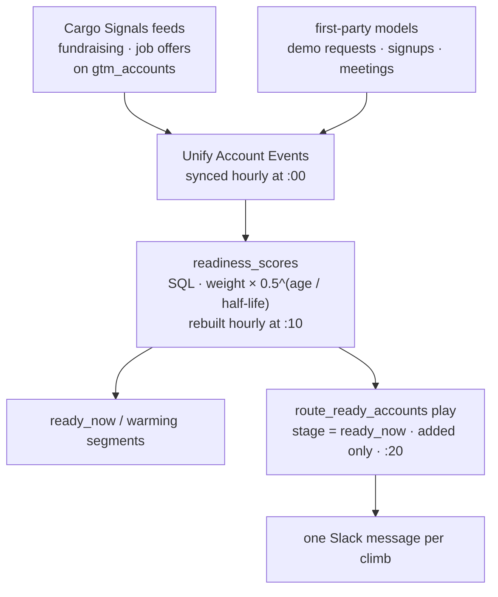

# Readiness scoring: a score that rises with fresh signals and falls as they age

Score every account on how ready it is right now, from its recent signals, with older signals
counting for less. This pipeline deploys the whole loop: signals in, a score rebuilt every hour,
and a Slack message when an account crosses the line.

```sh
cargo-ai project add cookbook/readiness-scoring
```

1. **Signals in.** Two Cargo Signals feeds watch the accounts in `gtm_accounts` for rounds raised
   and jobs posted. Every event lands in Unify Account Events, next to whatever else already unifies
   there: demo requests, signups, CRM meetings, web sessions.
2. **Scored.** `readiness_scores` is a SQL model over Account Events. Each event counts for its
   weight times one half per half-life of age, both set per signal type in `infra/settings.ts`, and
   the sum is the score. It is rebuilt hourly, so the age is always today's.
3. **Routed.** Two segments read the stage the query computes (`ready_now`, `warming`), and a play
   posts each account that enters `ready_now` to Slack, once.

```ts
// infra/settings.ts
export const signals = {
  fundraising: { weight: 10, halfLifeDays: 120 },
  job_offers: { weight: 4, halfLifeDays: 21 },
  demo_requests: { weight: 20, halfLifeDays: 30 }, // a first-party model, by slug
};
export const readyThreshold = 8;
export const warmingThreshold = 4;
```

## Why the decay lives in SQL

A computed column cannot read the clock, and a score written onto a row by a play is right only on
the day it is written. The obvious fix, a play that rewrites every score every hour, runs a workflow
per account per hour to do arithmetic. Here the events are never touched: the score is a query that
computes each event's age when it runs, and the model is rebuilt on a schedule. An account with no
new signal cools down with no write at all.

## Why everything goes through Account Events

The score reads one model. Any source that unifies as an account event (a Cargo Signals feed, a
webhook model of demo requests, a CRM's meetings) reaches it with no change to the query. The key
for a weight is the event's Cargo Signals `signal_type`, or the source model's slug when it has
none. A key with no weight counts for nothing, so a new source never moves scores until someone
has decided what it is worth.

## How it works



| File                                  | Resource           | Role                                                                     |
| ------------------------------------- | ------------------ | ------------------------------------------------------------------------ |
| `infra/settings.ts`                   | (not a resource)   | weights and half-lives per signal type, the two thresholds, the horizon  |
| `infra/models/account-events.ts`      | `defineModel`      | Unify Account Events, adopted, with its hourly schedule                  |
| `infra/models/signal-feeds.ts`        | `defineModel` ×2   | Cargo Signals fundraising and job offers, on a watchlist, as account events |
| `infra/models/gtm-accounts.ts`        | `defineModel`      | the watched accounts, the shared native accounts model                   |
| `infra/models/readiness-scores.ts`    | `defineModel`      | the score: a native `defineQuery` model generated from `settings.ts`     |
| `infra/segments/readiness.ts`         | `defineSegment` ×2 | `ready_now_accounts`, `warming_accounts`                                 |
| `infra/plays/route-ready-accounts.ts` | `definePlay`       | the Slack post on entering `ready_now`, ships disabled                   |
| `infra/connectors/*.ts`               | `defineConnector`  | Cargo Signals and Slack, bound                                           |
| `infra/folders/index.ts`              | `defineFolder` ×2  | models and plays, named after the skill                                  |

## Placeholders (edit before deploy)

1. **`signals`** in `infra/settings.ts`, from the inventory query in
   [`references/run.md`](references/run.md) and [`references/weights.md`](references/weights.md).
2. **The thresholds**, after the pilot.
3. **The job title filter** on the job offers feed.
4. **The Slack channel id** in `infra/plays/route-ready-accounts.ts`.

## Cost

The score bills nothing: it is SQL over the workspace's own warehouse, with no LLM. Cargo Signals
bills per event delivered on the watched accounts, capped per day by each feed's
`dailyLeadLimit`. The Slack post is one action per account that crosses the line.

## Verification

```sh
node --import tsx evals/contract.mjs   # the graph boundaries, from the compiled registry
cargo-ai project types && cargo-ai project check && cargo-ai project plan
```

`evals/acceptance.md` is the line-by-line acceptance test.

## Composes into

`account-scoring` for the fit gate, `contact-sourcing` and `agentic-engagement` on
`ready_now_accounts`. Works best after `tam-building` or a CRM sync has put the accounts in Unify
Accounts.
