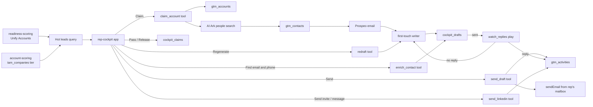

# Rep cockpit: claim a hot account, get the committee with drafts, send, and work the replies

A hosted app your reps work from every day, behind the Cargo login. It lists the accounts that
are ready now, best fit first, with the signals behind them, settles who is on each one, and turns
a claim into a buying committee with a first-touch email per person, sent from the rep's own Cargo
mailbox. Then it watches each thread: a reply lands on the card, and silence gets a follow-up
drafted in the thread for the rep to send.

```sh
cargo-ai project add cookbook/rep-cockpit
```

1. **Hot leads.** One SQL query over Unify Accounts (readiness-scoring's stage and score) and the
   tiered companies (account-scoring's tier): ready now or warming, tier A then B, nobody holding
   it. Each row shows the company's logo and LinkedIn page and the three signals adding most to its
   score, from Account Events, and filters by tier, readiness, signals or name. Claim, Pass with a
   reason (a "not now" returns in 90 days), or add an account by its website.
2. **Claim.** The app starts one tool run, `rep_cockpit_claim_account`: the account is upserted on
   `gtm_accounts`, AI Ark searches the buying committee at its domain, each person lands on
   `gtm_contacts`, Prospeo finds the work email, and the first-touch writer drafts one email per
   person onto `cockpit_drafts`. The claim row on `cockpit_claims` reads `ready` when it is done.
3. **Work the account.** On the account page the rep edits a draft, or asks the writer for a
   rewrite (`rep_cockpit_redraft`), or looks up a missing email and a mobile
   (`rep_cockpit_enrich_contact`), and clicks Send. `rep_cockpit_send_draft` sends it with native
   `sendEmail` from the mailbox attached to the rep's member, marks the draft sent, and writes an
   `email` row on `gtm_activities`. Under each email, the writer's LinkedIn note goes out as an
   invite or a message from the rep's own LinkedIn identity (`rep_cockpit_send_linkedin`). The
   Timeline beside it reads every activity on the account.
4. **Replies and follow-ups.** The play `rep_cockpit_watch_replies` starts on every draft that
   becomes sent and waits on its thread with `waitEmailEvent`. A reply marks the card replied, with
   its first lines, and logs it on the timeline; the rep's Meeting booked logs the meeting. No reply
   in four days, and the writer drafts a follow-up that the send tool threads under the first
   email. The play never sends.

## Why a claim is one tool run

A claim is four paid steps per person. Run from the browser, a closed tab mid-claim leaves an
account claimed with nobody sourced, and nothing on screen says so. As one tool run it finishes
whatever the rep does next, and the claim row says `running`, `ready` or `failed`.

## Why the reply watch is a play

A wait of days does not fit in the send's run: the rep's click would hang on it. A play on
`cockpit_drafts` filtered to `sent` starts one run per send, on its own schedule, and a row that
goes back to `sent` after a follow-up is picked up again. The waits run side by side, and every
outcome lands on the same row the account page reads.

## Why the mailbox comes from the member

The app finds the signed-in rep's revenue-organization member by login email and sends from its
first mailbox. `defineMember(email, { mailboxes })` is where that link lives, in the project, so
adding a rep is a reviewed change to `infra/members/reps.ts` and no rep table hides in the app.
The LinkedIn identity needs no table either: the Cargo Chrome extension writes it to the rep's own
Cargo user (`webExtensionData.edgesIdentityUid`), and the app reads it from the signed-in user.

## How it works



| File                                    | Resource       | Role                                                       |
| --------------------------------------- | -------------- | ---------------------------------------------------------- |
| `infra/apps/cockpit.ts`                 | `defineApp`    | the app, with the tool and model ids it calls as `env`     |
| `infra/apps/cockpit/`                   | Vite app       | Hot leads, My accounts, the account page and its timeline  |
| `infra/tools/claim-account.ts`          | `defineTool`   | account, committee, emails, drafts, in one run             |
| `infra/tools/send-draft.ts`             | `defineTool`   | the send (a follow-up in its thread), the two writes       |
| `infra/tools/send-linkedin.ts`          | `defineTool`   | a LinkedIn invite or message as the rep, and its log       |
| `infra/tools/redraft.ts`                | `defineTool`   | a rewrite of one draft, as the rep asks                    |
| `infra/tools/enrich-contact.ts`         | `defineTool`   | one person's work email and mobile, on a click             |
| `infra/plays/watch-replies.ts`          | `definePlay`   | the wait on each sent thread: reply logged, or follow-up   |
| `infra/agents/first-touch-writer.ts`    | `defineAgent`  | first touches, rewrites and follow-ups, no writes          |
| `infra/models/cockpit-claims.ts`        | `defineModel`  | who works which account, by domain                         |
| `infra/models/cockpit-drafts.ts`        | `defineModel`  | one draft per sourced person                               |
| `infra/models/gtm-*.ts`                 | `defineModel`  | the shared accounts, contacts and activities               |
| `infra/domains/`, `infra/mailboxes/`    | domain/mailbox | the sending domain and one mailbox per rep                 |
| `infra/members/reps.ts`                 | `defineMember` | each rep's mailbox                                         |
| `infra/settings.ts`                     | settings       | people per claim, the committee, follow-up timing          |

The skill: [`SKILL.md`](SKILL.md). The pilot: [`references/run.md`](references/run.md).
