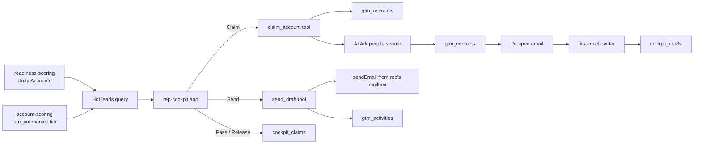

# Rep cockpit: claim a hot account, get the committee with drafts, send from your own mailbox

A hosted app your reps work from every day, behind the Cargo login. It lists the accounts that
are ready now, best fit first, settles who is on each one, and turns a claim into a buying
committee with a first-touch email per person, sent from the rep's own Cargo mailbox.

```sh
cargo-ai project add cookbook/rep-cockpit
```

1. **Hot leads.** One SQL query over Unify Accounts (readiness-scoring's stage and score) and the
   tiered companies (account-scoring's tier): ready now or warming, tier A then B, nobody's claim
   on it. Claim or Pass.
2. **Claim.** The app starts one tool run, `rep_cockpit_claim_account`: the account is upserted on
   `gtm_accounts`, AI Ark searches the buying committee at its domain, each person lands on
   `gtm_contacts`, Prospeo finds the work email, and the first-touch writer drafts one email per
   person onto `cockpit_drafts`. The claim row on `cockpit_claims` reads `ready` when it is done.
3. **Send.** On the account page the rep edits a draft and clicks Send. `rep_cockpit_send_draft`
   sends it with native `sendEmail` from the mailbox attached to the rep's member, marks the draft
   sent, and writes an `email` row on `gtm_activities`.

## Why a claim is one tool run

A claim is four paid steps per person. Run from the browser, a closed tab mid-claim leaves an
account claimed with nobody sourced, and nothing on screen says so. As one tool run it finishes
whatever the rep does next, and the claim row says `running`, `ready` or `failed`.

## Why the mailbox comes from the member

The app finds the signed-in rep's revenue-organization member by login email and sends from its
first mailbox. `defineMember(email, { mailboxes })` is where that link lives, in the project, so
adding a rep is a reviewed change to `infra/members/reps.ts` and no rep table hides in the app.

## How it works



| File                                    | Resource       | Role                                                       |
| --------------------------------------- | -------------- | ---------------------------------------------------------- |
| `infra/apps/cockpit.ts`                 | `defineApp`    | the app, with the tool and model ids it calls as `env`     |
| `infra/apps/cockpit/`                   | Vite app       | Hot leads, My accounts, the account page                   |
| `infra/tools/claim-account.ts`          | `defineTool`   | account, committee, emails, drafts, in one run             |
| `infra/tools/send-draft.ts`             | `defineTool`   | the send, the draft marked sent, the activity row          |
| `infra/agents/first-touch-writer.ts`    | `defineAgent`  | one email per person, from context, no writes              |
| `infra/models/cockpit-claims.ts`        | `defineModel`  | who works which account, by domain                         |
| `infra/models/cockpit-drafts.ts`        | `defineModel`  | one draft per sourced person                               |
| `infra/models/gtm-*.ts`                 | `defineModel`  | the shared accounts, contacts and activities               |
| `infra/domains/`, `infra/mailboxes/`    | domain/mailbox | the sending domain and one mailbox per rep                 |
| `infra/members/reps.ts`                 | `defineMember` | each rep's mailbox                                         |
| `infra/settings.ts`                     | settings       | people per claim and the buying committee filters          |

The skill: [`SKILL.md`](SKILL.md). The pilot: [`references/run.md`](references/run.md).
