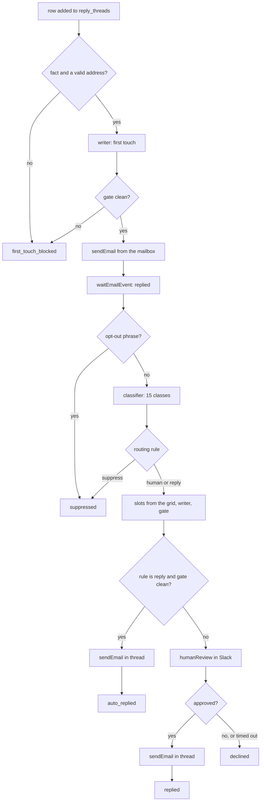

# Reply handling: every reply answered, a person approves each answer

To answer replies to your outbound without letting a model email your leads unsupervised, run the
whole conversation through one play: it sends the first touch from a mailbox your workspace owns,
waits on that thread, stops opt-outs before any model reads them, classifies the reply, drafts the
answer, and holds it in Slack until a person approves, edits or declines it.

```sh
cargo-ai project add cookbook/reply-handling
```

This is the reply loop from the AutoGTM demo at Cargo's GTM engineering demo night in San Francisco
(September 2026), with that build's company, people, domain and event logic taken out. The lessons
it paid for are kept, in the code comments and in `SKILL.md`.

## What it does

- **Owns the thread.** The play sends the first touch itself, from the declared mailbox, so
  `waitEmailEvent` has a message to wait on and the answer goes out from the address the lead
  wrote back to.
- **Stops opt-outs first.** A phrase list runs before any model. "Please take me off this list" is
  recorded as `suppressed` and never classified, drafted or answered.
- **Classifies into fifteen classes**, with a confidence, the reader's tone, and their time
  preferences in their own words.
- **Routes by rules in code.** `infra/settings.ts` says, per class: a person reviews it, it answers
  itself, or it stops. Every class that deserves an answer starts at "a person reviews it".
- **Drafts and gates.** Times from a meeting grid, the answer from a writer that reads your reply
  playbook in the workspace context, and a deterministic gate that fails closed.
- **Asks a person.** A context post and a review card in one Slack channel. Approve sends the
  answer, edited or not, in the same thread.
- **Keeps a ledger.** Every stage writes onto the person's row in `reply_threads`.

## How it works



| File                                          | Resource          | Role                                                                     |
| --------------------------------------------- | ----------------- | ------------------------------------------------------------------------ |
| `infra/domains/outreach.ts`                   | `defineDomain`    | the sending domain, adopted                                              |
| `infra/mailboxes/sender.ts`                   | `defineMailbox`   | the From inbox for the first touch and every answer; monthly charge      |
| `infra/models/reply-threads.ts`               | `defineModel`     | one row per person: adding a row starts the loop, every stage writes it  |
| `infra/agents/reply-classifier.ts`            | `defineAgent`     | fifteen classes, confidence, tone, time preferences; JSON                |
| `infra/agents/reply-writer.ts`                | `defineAgent`     | first touch and answers, from the reply playbook in context; JSON        |
| `infra/plays/handle-replies.ts`               | `definePlay`      | the loop, realtime on rows added, shipped disabled                       |
| `infra/scripts/reply/*.ts`                    | (script nodes)    | row guard, hard stop, routing, slots, gate, final body                   |
| `infra/settings.ts`                           | (not a resource)  | review channel, routing rules, confidence floor, meeting grid            |
| `infra/connectors/anthropic.ts`, `slack.ts`   | `defineConnector` | the LLM and the review channel, both bound to the workspace's defaults   |
| `infra/folders/index.ts`                      | `defineFolder`    | one folder per kind, named after the skill                               |
| `context/reply-playbook.md`                   | (context file)    | the example playbook for the project's context repo                     |

## Why it is built this way

**One play, not an agent.** The steps that must never vary (the hard stop, the routing, the gate,
the review) are deterministic nodes, so they cannot be talked out of by a reply. The models do the
two things only a model can do: read a reply and write an answer. `agentic-engagement` is the other
shape, where an agent holds the conversation; this one is for teams that want a person on every
answer first.

**The hard stop is a phrase list.** A model can misread "please take me off your list" as a
negative reply worth a polite answer. A phrase list cannot, and it costs nothing to run.

**The decision is read from the review node's output.** `humanReview(...)` called without bodies
returns the literal `null`, so branching on its return value records every approval as a decline.
That happened three times on live approvals before the cause was found. The bodies would fix the
return value, but they merge into one end node through `??`, which this repo's authoring guide lists
as failing at run time. Reading `nodes.humanReview.approved` in a script is the version that ran.

**Times never come from the writer.** In the build this comes from, a writer left to reason about
availability declined the exact day the reader asked for ("My Thursdays are unfortunately booked").
Now the classifier keeps the reader's own words, the slot script reads weekday words and dates, the
writer may only offer what the slots offered, and the gate compares instants, because the engine
rewrites ISO offsets to UTC between nodes.

**The row says `approved` before the send.** Cargo spaces a mailbox's sends by its daily ceiling, so
on a young mailbox an approved answer can wait hours for its slot. A row that still read
`pending_review` in that window looked like a lost click.

## Placeholders (edit before deploy)

1. **Sending domain**: `infra/domains/outreach.ts`, a domain the workspace bought through Cargo.
2. **Mailbox identity**: `infra/mailboxes/sender.ts`, a real person, and `senderName` to match.
3. **Review channel**: `reviewChannelId` in `infra/settings.ts`, a channel id from the Slack
   connector's autocomplete.
4. **Meeting grid**: `meetingGrid` in `infra/settings.ts`, the sender's UTC offset and hours.
5. **Language model**: `languageModel` on both agents.
6. **Phrase lists**: the hard-stop phrases (`screen-reply.ts`) and banned phrases (`check-draft.ts`).
7. **Reply playbook**: `context/reply-playbook.md`, rewritten for your company in the project's
   context repo.

## What it does not do

It does not source or enrich the people it writes to, follow up on silence, book the meeting, or
write to a CRM. A row is added by whoever decided to write to that person; the first touch needs a
fact on the row; the answer proposes times and a person sends the invite. The CRM write, the
follow-up and a calendar lookup are variations in `SKILL.md`.
