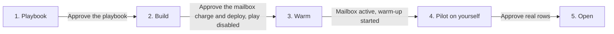

# Reply handling

**State: to-be-approved.** Deploy-verified against a live workspace: not yet. Treat `Done when`
below as the acceptance test and review `cargo-ai project plan` before deploying. Make no outcome claim
for this skill until it is approved.

## The outcome

Every reply to your outbound gets an answer a person signed off on, in the same thread, drafted as
soon as the mailbox's inbound sync picks the reply up. The person does not write it: they read a
card in Slack with what came in, how it was read and the drafted answer, and click Approve, Edit or
Decline. Nothing reaches a lead without that click unless someone changed a routing rule in code.

One row in, one conversation out. Adding a person to `reply_threads` starts a run that writes a
first touch from the row's one observed fact, sends it from a mailbox the workspace owns, and
sleeps on that thread. When they reply, the run wakes and works in this order:

1. **Hard stop.** A phrase list catches opt-outs and legal language before any model reads the
   reply. The row is marked `suppressed` and nothing more happens.
2. **Classify.** One of fifteen classes, with a confidence, the reader's tone and their time
   preferences in their own words.
3. **Route.** The rules table in `infra/settings.ts` says, per class, whether a person reviews it,
   it answers itself, or it stops. Every class that deserves an answer starts at "a person
   reviews it".
4. **Draft and gate.** Times come from your meeting grid, the answer from a writer that reads your
   reply playbook in the workspace context, and a deterministic gate flags machine tells, times
   nobody offered, and bodies too short or too long.
5. **Review and send.** The card lands in your channel; Approve sends the answer, edited or not,
   in thread from the same mailbox.

Every stage writes onto the person's row, so where each conversation stands is one query.

**Two failure modes worth knowing before you start.** Reading the review decision from what
`humanReview` returns, instead of from the node's own output, sends every approval down the
declined path while the node says `approved: true`. And a young mailbox spaces its sends by its
daily ceiling: at five a day an approved answer can wait hours for its slot, which looks like a
lost click unless the row says `approved` first. This play handles both; an adaptation must not undo
either.

## Example

> Email each person we add with a first touch, and when they reply, draft the answer and let me approve it in #replies before it goes out.

Illustrative output, fictional records:

| Person (company)              | Their reply                                                       | Class (confidence)            | What happened                                                                                          |
| ----------------------------- | ----------------------------------------------------------------- | ----------------------------- | ------------------------------------------------------------------------------------------------------ |
| Priya Raman (northwind.example) | "Sounds good. Thursday afternoon works, anything after 2pm."      | super_positive_meeting (0.92) | Card offered Thursday at 2pm or Friday at 3pm; approved with one word changed; sent in thread, `replied` |
| Tomás Ortega (fabrikam.example) | "Not right now. Try me again in Q2."                              | positive_timing (0.88)        | Draft acknowledged the window; the reviewer declined it; `declined`, nothing sent                      |
| Sam Hale (tailspin.example)     | "Please take me off this list."                                   | hard_stop                     | Stopped by the phrase list before any model ran; `suppressed`                                         |
| Mei Lin (contoso.example)       | "I am out of the office until Monday."                            | out_of_office (0.97)          | Suppressed by the rules table, no draft; `suppressed`                                                  |

Four replies: one answer sent after an edit, one declined in Slack, two stopped without a draft.

## Guide the operator through every phase



Every substantive message starts with the current phase and ends with a `Next step` section giving
the operator one concrete decision, what it unlocks, and what stays blocked. Never end with a
generic offer to help.

1. **Playbook.** Read the workspace context for who sends, what they offer, how they write and what
   they may claim. Draft `reply-playbook.md` from it, with this skill's `context/reply-playbook.md`
   as the shape, and have the operator correct it. Nothing bills in this phase.
2. **Build.** Reconcile, adapt, run the contract, types, check and plan, and show the plan: the
   domain, the mailbox, the ledger model, two agents and the play **disabled**. Quote the live
   mailbox price as a monthly charge. Deploy only on a yes to that charge.
3. **Warm.** Wait for the mailbox to be active and start warm-up
   ([`references/run.md`](references/run.md#warm)). Report the day's send allowance.
4. **Pilot on yourself.** Enable the play and add one row for the operator's own address. Walk the
   loop with them: the first touch arrives, they reply, the card arrives, they approve with an edit,
   the answer lands in the same thread. Then a second address replies "please remove me" and stops
   at `suppressed` with no agent run. Report every row and run.
5. **Open.** Only on an explicit yes after the pilot, add real people, and only people the operator
   named. Report what is `waiting`, `pending_review` and `replied`, with a direct Cargo link to the
   model.

## Put it in your project

This folder is a **worked example**: real project resources written for some other company. The job
is to end up with the code your company would have written, in your project, and an agent does the
adapting.

**Install the required authoring skill first.** If `cargo-project` is absent, run:

```sh
npx skills add getcargohq/cargo-skills --skill cargo-project
```

Then read `.agents/skills/cargo-project/SKILL.md` directly; no session reload is needed. Complete its
bootstrap and use its authoring, state, plan, and deployment rules throughout. Stop before any
template work if the skill cannot be installed or read.

1. **Install it: the CLI does the copy.** From inside the project (the folder holding `cargo.json`),
   `cargo-ai project add cookbook/reply-handling` writes this example to `infra/reply-handling/` and
   this procedure to `.claude/skills/reply-handling/`. No project yet?
   `cargo-ai project init <dir> --cookbook reply-handling && cd <dir> && npm install` does both.
   **If you are reading this from the project's `.claude/skills/`, the install already happened:
   start at step 2.** On a CLI too old to have `add`, copy this folder in as a sibling of what is
   there by hand; everything below is unchanged.
2. **Reconcile it with what is already declared.** For every domain, mailbox, LLM or Slack
   connector, or folder this example carries that the project already has, rewire the imports to
   the existing one and drop the copy: two resources with one slug collide at deploy. When
   `agentic-engagement` is installed, its domain is this one; a second mailbox is a second monthly
   charge, so decide with the operator whether the loops share one. This skill declares no
   `defineContext`: that resource is a per-workspace singleton the project owns. Copy
   `context/reply-playbook.md` into the project's context only when no playbook exists there. This
   folder needs nothing in `.env`.
3. **Write or confirm the playbook.** Phase 1 above. It goes in the project's context repo, never
   into the writer's prompt.
4. **Adapt and deploy disabled.** Work the sections below in order: _What should not change_ is
   what you argue back about (say what breaks, then do it if they still want it); _What you can
   change_ is what you offer unprompted; _What you will be asked_ is the floor, and you derive
   before you ask. Record what you changed and why under a `## Decisions` section in your copy of
   this file. Then run `node --import tsx evals/contract.mjs` from this skill's folder, followed by
   `cargo-ai project types && cargo-ai project check && cargo-ai project plan` from the project root.
   Show the diff. A `+ create mailbox:…` line is a monthly charge, not a one-off: quote the live
   figure from `cargo-ai mailboxManagement pricing get` and deploy only on an explicit yes. Never
   run `cargo-ai project init --force` in a non-empty directory.
5. **Warm, pilot, open.** Follow [`references/run.md`](references/run.md), then walk _Done when_
   line by line with evidence. Deployed cleanly and sent nothing is the normal failure; the second
   is a reply that never wakes the run, which only a pilot on your own address catches.

## What you will be asked

**Derive before you ask.** An input with a lookup is looked up, not asked.

| Input             | Kind    | How it is answered                                                                                                                                                       | Why it matters                                                                                                                       |
| ----------------- | ------- | ------------------------------------------------------------------------------------------------------------------------------------------------------------------------ | ------------------------------------------------------------------------------------------------------------------------------------ |
| `sendingDomain`   | derived | A domain the workspace bought through Cargo, from `cargo.state.json`, an existing `defineDomain`, or the Cargo UI (Settings, Domains). Ask only when none exists          | A mailbox provisions only on a domain Cargo registered; a domain connected from another registrar answers `providerNotSupported`     |
| `mailboxIdentity` | asked   | First name, last name and username of a real person (`infra/mailboxes/sender.ts`), and the same name as `senderName`                                                    | The From name is what the lead sees and the writer signs as. Domain, username and type are create-only                               |
| `mailboxCharge`   | asked   | `cargo-ai mailboxManagement pricing get` for the type, said out loud as a monthly cost, approved before the deploy                                                       | A mailbox bills every month until `destroy`                                                                                          |
| `reviewChannel`   | asked   | Which channel the reviewers read. Resolve its id through the Slack connector's autocomplete and set `reviewChannelId` in `infra/settings.ts`; never type a name           | The card carries a lead's words. A wrong id posts them somewhere else, or nowhere, and the run waits on a card nobody sees            |
| `playbook`        | asked   | Drafted from the workspace context (positioning, voice, offer) and corrected by the operator, as `reply-playbook.md` in the context repo                                 | Every claim the writer may make comes from it. A thin playbook is a writer that invents an offer                                      |
| `languageModel`   | derived | Whichever LLM connector the workspace already holds (`cargo-ai connection connector list`)                                                                               | Draft quality and the cost per reply both live here                                                                                  |
| `meetingGrid`     | derived | `infra/settings.ts`: weekdays, 9 to 4 on the hour, 30 minutes, the sender's UTC offset. Ask only for the offset when the sender's time zone is not in the context         | Every time the writer offers comes from here; a wrong offset offers 3am                                                               |

Checked before moving on, not after the deploy:

- `sendingDomain`: the declaration matches a domain the workspace owns, and MX, SPF and DKIM resolve
  for it
- `mailboxIdentity`: a real person, a valid local part, and `senderName` equal to the From name
- `mailboxCharge`: the plan's `+ create mailbox:…` line was approved against a live `pricing get`
- `reviewChannel`: the id resolves to the channel the operator named, and the Cargo app is in it
- `playbook`: it names the offer, the ask and the meeting, and lists what the sender never claims

## What you can change

The code is a worked example. These reshapes are expected, and the agent offers them rather than
waiting to be asked. Every one costs something; that is what makes it a variation and not the
default.

| Variation              | When it is right                                                                                         | How                                                                                                                                                                                    | What it costs                                                                                                                                                                  |
| ---------------------- | -------------------------------------------------------------------------------------------------------- | -------------------------------------------------------------------------------------------------------------------------------------------------------------------------------------- | ------------------------------------------------------------------------------------------------------------------------------------------------------------------------------ |
| `reply-mode-for-a-class` | Reviewers have approved one class's drafts unchanged for weeks (say `positive_timing`)                 | Change that class to `"reply"` in `routingRules` (`infra/settings.ts`); the gate and `confidenceFloor` still send anything doubtful to a person                                        | That class reaches leads with nobody reading it first. Keep the diff and the reason; review its `auto_replied` rows weekly                                                     |
| `research-first-touch` | Rows arrive without a fact, from a list or a form                                                        | Before the writer, one web search on the person and company and a research agent that returns one grounded sentence or nothing; write it to `fact`, then let `checkRow` decide         | One search and one agent call per row. An empty result still blocks the row: no fact, no email                                                                                 |
| `calendar-slots`       | The sender's calendar, not a grid, should decide the times                                              | Replace `proposeSlots` (`infra/scripts/reply/propose-slots.ts`) with a free/busy lookup through a calendar connector; keep its output shape, so the gate still checks every time       | A calendar connection to keep authorized and one lookup per meeting reply. The gate's instant comparison stays: the engine rewrites offsets to UTC between nodes               |
| `mailbox-pool`         | Volume above what one mailbox's ramp allows                                                              | Declare several mailboxes and pick one per person by a hash of the recipient's address, in a script before the first send; use the same pick for the answer                           | A monthly charge per mailbox, each warming on its own. They share the domain's reputation, so this spreads the rate, not the risk                                              |
| `crm-backed`           | Reps live in HubSpot or Salesforce and should see the class and status there                            | After the approved send, `updateRecords` on the contact matched by email with the class, positivity, status and reply time, `continueOnFailure: true`                                 | A CRM connection and four properties to create. A failed CRM write must not block an answer the lead is waiting for                                                            |
| `loop-alerts`          | Nobody watches the ledger, and a stuck loop would go unnoticed                                          | `defineAlert` on this play's failed runs, posting to the review channel, and one on zero runs in a day while rows are being added                                                       | Two alert resources, evaluated on a schedule. An alert on model freshness measures the model definition's age, not new rows: do not use it as a heartbeat                     |
| `follow-up-on-silence` | One more touch on a thread that stayed quiet                                                            | `continueOnFailure` on the wait, branch on `matched`, and a second, gated draft. Not exercised live: read the wait's failed output on a pilot row before trusting the branch           | A second email per silent person, from a mailbox whose ramp you are already spending. `agentic-engagement`'s heartbeat is the tested way to handle silence                     |

## What should not change

However far you adapt, these hold. Ask for one anyway and the agent tells you what breaks, then does
it if you still want it, and records why under `## Decisions` in your copy of this file.

- **A row is an email to a real person.** (`infra/models/reply-threads.ts`) Only people the operator
  named are added, and nobody is added to test something: the pilot uses the operator's own
  address. There is no dry run once the play is on.
- **`changeKinds: ["added"]` stays.** (`infra/plays/handle-replies.ts`) Every stage writes the row.
  Enrol on updates too and each ledger write starts the conversation again: a second first touch to
  the same person.
- **The hard stop runs before any model.** (`infra/scripts/reply/screen-reply.ts`) Move it after the
  classifier and an opt-out is read, drafted and, in Reply Mode, answered.
- **The play sends the first touch, from the declared mailbox.** (`infra/plays/handle-replies.ts`)
  The wait keys off that message: a thread a sequencer started is one this play never hears back
  on. A mailbox computed per run answers from an address the lead did not write to.
- **Answers carry `inReplyTo` and the full `references` chain, oldest first.**
  (`infra/plays/handle-replies.ts`) Without them mail clients split the conversation, and the lead
  sees a new email from a stranger.
- **The decision is read from the review node's output.** (`infra/plays/handle-replies.ts`)
  `nodes.humanReview.approved === true`, in a script after the review. Branch on what
  `humanReview(...)` returns instead and every approval is recorded as a decline.
- **The gate fails closed.** (`infra/scripts/reply/check-draft.ts`) Any flag sends the draft to a
  person whatever the rule says, and a flagged first touch is not sent at all. Loosen it and the
  first lead to see a machine tell is the one who reports it.
- **No fact, no email.** (`infra/scripts/reply/check-row.ts`) A first touch with nothing true to
  say is the shape of spam, and it spends the mailbox's reputation on everyone else.
- **Times come only from the slot step.** (`reply-writer.prompt.ts`, `check-draft.ts`) The writer
  may not invent availability, and the gate flags any time the slots did not offer. A writer left to
  reason about the calendar once refused the exact day the reader asked for.
- **Routing rules are code, and every class starts in Human Mode.** (`infra/settings.ts`) A rule
  someone can flip in a UI is a rule nobody reviewed. `hard_stop`, `spam` and `out_of_office` are
  never answered.
- **The agents hold nothing.** (`infra/agents/`) The writer and the classifier return text; only
  the play writes and sends. An agent that can send decides its own routing.
- **Company knowledge lives in the context repo.** (`reply-playbook.md`) In the prompt, a change of
  offer becomes a deploy and stops being reviewable.

## Done when

- `cargo-ai project plan` showed the domain, the mailbox, `reply_threads`, both agents and the play
  disabled, and the operator approved the monthly mailbox line against a live `pricing get`
- `node --import tsx evals/contract.mjs` passes against the adapted resources
- the mailbox is `active`, warm-up has started, and `get-send-allowance` returns a daily limit
- the pilot row for the operator's own address received a first touch from the declared address,
  and the row reads `waiting` with `touch_message_uuid` set
- the operator's reply woke the run: the context post and the review card landed in the review
  channel, and the row reads `pending_review` with a class, a confidence and a gate result
- an approval after an edit sent the edited answer in the same thread (same subject with `Re:`,
  threaded in the operator's mail client), and the row reads `replied` with `review_decision`
  `edited` and the reviewer's name
- a reply saying "please remove me" from a second address ended at `suppressed` with
  `routing_reason` naming the phrase, and its run trace shows no agent node after the wait
- a decline sent nothing and the row reads `declined`
- no class in `routingRules` is `"reply"`, unless the operator changed one and the reason is
  recorded under `## Decisions`

## What it costs

Fetch live prices before every estimate, and quote the lookup time with the estimate.

**The mailbox is the fixed cost.** A monthly, recurring charge for as long as it exists: read
`monthlyCredits` from `cargo-ai mailboxManagement pricing get` for the type and say it as a
per-month figure. `destroy` is the only way it stops. Adopting a domain costs nothing; a
`+ create domain:…` line in the plan is a separate, non-refundable registration.

**Each person costs one writer call, one send and the run's node executions.** Each reply that is
not stopped by the phrase list adds one classifier call, one writer call and, when approved, one
more send. Read the per-send price with `cargo-ai connection native-integration get` (or
`orchestration action list sendEmail`), and the model's price from the LLM connector. The pilot's
actual credits per person and per reply are the numbers to multiply.

**The ramp is the real limit, and it is time, not credits.** A mailbox starts at five real sends a
day and reaches its target over forty-five days of warm-up. Cargo spaces sends by the daily ceiling,
one every 1440 minutes divided by the ceiling, so at five a day a send waits up to 288 minutes for
its slot. The approved answer takes a slot too. Check `mailbox get-send-allowance` before promising
volume, and add mailboxes (`mailbox-pool`) rather than expecting one to send faster.

## Composes into

`customer-lookalikes` (the people worth a first touch, with the fact to open on),
`new-hire-detection` (people who just took a role you sell to), and `account-scoring` (who to add
first). `agentic-engagement` is the next step for a class whose drafts no longer need a person, and
`meeting-prep` takes over once a reply becomes a meeting.
