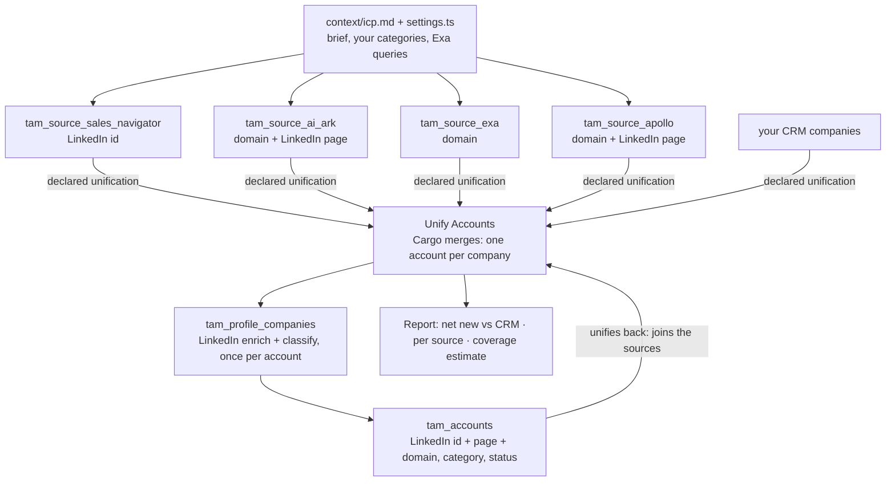

# TAM building, advanced: one TAM from four sources

To build a total addressable market (TAM) that is as complete as you can make
it, give the same brief to four sources, merge everything they find into one
account per company, classify every company into your own categories, and
measure how much of the market you still miss. This pipeline does that in
Cargo: Sales Navigator, AI Ark, Exa and Apollo land in their own models, Cargo's
account unification merges them (with your CRM's companies) into Unify
Accounts, one play reads each account once from LinkedIn and classifies it, and
the report says what is net new and estimates the companies no source found.

```sh
cargo-ai project add cookbook/tam-building-advanced
```

`tam-building` is the single-source version: one AI Ark search, one model. Start
there when one source and a list are enough. Come here when the question is
"how much of my market do I actually have?"

## Why four sources

No data provider is your market. Each one answers the brief its own way, and
each misses companies the others find:

| Source          | Its job                                                     |
| --------------- | ----------------------------------------------------------- |
| Sales Navigator | The census: every company LinkedIn files under your filters |
| AI Ark          | Lookalikes of the customers you name                        |
| Apollo          | A second census, in a different database                    |
| Exa             | Search by meaning: companies filed under labels nobody filters on |

In the build this pipeline is written from, the biggest source held most of
the market, and the companies it missed included a share of the accounts the
team most wanted to win. Combining is how you find them; the overlap is how you
measure what is still missing.

## How it works



1. **One brief, four translations.** Industries, company size and countries
   are written into every source, so they search the same market.
2. **Cargo merges, not a workflow.** Every source model declares how it
   identifies a company, and Cargo's account unification merges them into
   Unify Accounts, normalising LinkedIn URLs and domains itself. Your CRM's
   companies are in the same accounts, so "already in the CRM" is free.
3. **One profile per company.** One play, a build step run as a batch after
   each source sync, reads each account a TAM source found: a LinkedIn company
   enrich (the LinkedIn page any source gave, else the domain) and a
   classification, written to `tam_accounts`. A company four sources found is
   enriched once.
4. **The profile joins the sources.** Sales Navigator knows a company by its
   LinkedIn id, Apollo by the same id plus its domain and page name, AI Ark by
   its domain and LinkedIn page name, Exa by its website. Apollo and Sales
   Navigator merge on the id directly. For the rest, the profile row holds the
   LinkedIn id, the page, LinkedIn's domain and the account's own domain, and
   unifies back into the same account, so they become one.
5. **Your categories, not theirs.** Each company is classified from its own
   description into the categories in `settings.ts`, ideally your CRM's
   industry values. A provider's industry label is never trusted.
6. **Flag, never delete.** `status` and `exclusion_reason` are computed on
   `tam_accounts` from `settings.ts`: services firms, subsidiaries, companies
   out of size or country stay, with the reason.
7. **Measure what is missing.** Every account lists which sources found it.
   The report estimates the market from the Sales Navigator × Apollo overlap
   (capture-recapture) and gives your coverage.

| File                                          | Resource          | Role                                                     |
| --------------------------------------------- | ----------------- | -------------------------------------------------------- |
| `infra/connectors/*.ts`                       | `defineConnector` | the four sources and LinkedIn, on managed connections    |
| `infra/models/tam-source-*.ts`                | `defineModel`     | the four sources: filter, budget, no schedule, declared unification |
| `infra/models/tam-accounts.ts`               | `defineModel`     | one profile per company; `status` and `exclusion_reason` computed |
| `infra/models/accounts.ts`                    | `defineModel`     | Unify Accounts, adopted, nothing else declared on it     |
| `infra/plays/profile-company.ts`              | `definePlay`      | the only play: LinkedIn enrich + classify, once per account |
| `infra/scripts/company-domain.ts`             | `defineScript`    | the domain: LinkedIn, the account, or the short link's landing |
| `infra/settings.ts`                           | (constants)       | size band, countries, your categories, the Exa queries   |

## Why these choices

- **Cargo's unification is the merge.** It already normalises LinkedIn URLs
  and domains and follows a chain of keys across rows. A workflow doing the
  same is slower, costs runs, and builds a second account layer next to the
  one every other pipeline reads.
- **The LinkedIn enrich is the identity.** It turns whatever a source gave
  (an id, a page name, a website) into the same three keys and the same
  columns, so a company Exa found reads exactly like one Sales Navigator found.
- **The domain is the best evidence available, never a short link.**
  LinkedIn's when it is a real domain; else the account's; else where
  LinkedIn's short link actually lands. A short link written as a domain is a
  key unrelated companies share, and Cargo would merge them.
- **Sources run one after another.** Profile one source's accounts before
  the next syncs, and the next source mostly merges onto accounts that already
  have a profile, for free.
- **The overlap is kept.** Every account lists which sources found it. The
  number is a fit signal, and the Sales Navigator × Apollo overlap is the
  coverage estimate.
- **Built once, refreshed at most quarterly.** A source sync re-bills every
  record, including the companies already in the TAM, and a TAM does not
  need to be fresher than three to four months. By default nothing is
  scheduled: re-source when you decide to, or take the `refresh` variation's
  quarterly cron.
- **Nothing is written outside Cargo.** Pushing the net new into the CRM is a
  separate, approved write.

## Placeholders (edit before deploy)

1. **The ICP and categories**: copy `context/icp.md` into the project's
   `context/`, or keep the one there.
2. **`infra/settings.ts`**: size band, countries, your categories, the Exa
   queries.
3. **Each source's filter and `limit`**: `infra/models/tam-source-*.ts`. Sales
   Navigator URLs come from `extract-sales-navigator-search` when the market is
   over 1,000 accounts.
4. **The CRM**: nothing to declare. Its companies model must unify into
   Unify Accounts (HubSpot and Salesforce companies do by default); the report
   reads its key in each account's `ids`.

## Verification

```sh
node --import tsx evals/contract.mjs
cargo-ai project types && cargo-ai project check && cargo-ai project plan
```

`evals/acceptance.md` is the line-by-line acceptance test.
