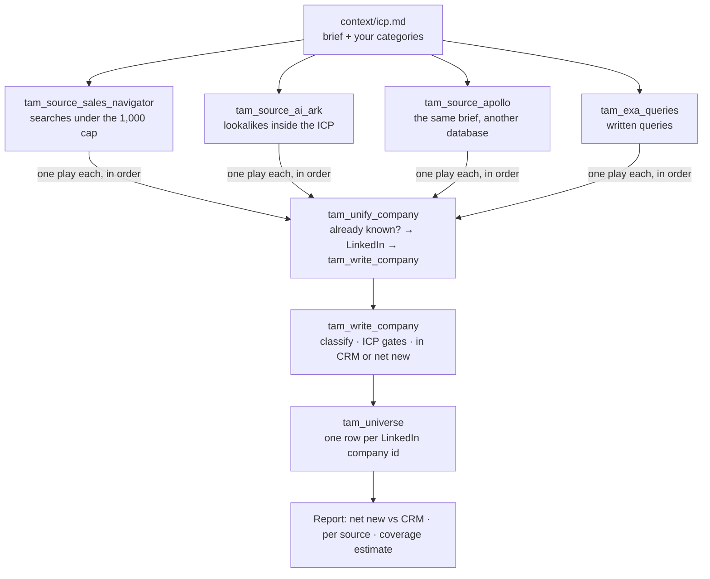

# TAM building, advanced: one TAM from four sources

To build a total addressable market (TAM) that is as complete as you can make
it, give the same brief to four sources, merge everything they find into one
table keyed on the LinkedIn company id, classify every company into your own
categories, and measure how much of the market you still miss. This pipeline
does that in Cargo: Sales Navigator, AI Ark, Apollo and Exa feed one
`tam_universe` model, every company is marked net new or already in your CRM,
and the report estimates the companies no source found.

```sh
cargo-ai project add cookbook/tam-building-advanced
```

`tam-building` is the single-source version: one AI Ark search, one model. Start
there when one source and a list are enough. Come here when the question is
"how much of my market do I actually have?"

## Why four sources

No data provider is your market. Each one answers the brief its own way, and
each misses companies the others find:

| Source          | Its job                                                     |
| --------------- | ----------------------------------------------------------- |
| Sales Navigator | The census: every company LinkedIn files under your filters |
| AI Ark          | Lookalikes of the customers you name                        |
| Apollo          | A second census, in a different database                    |
| Exa             | Search by meaning: companies filed under labels nobody filters on |

In the build this pipeline is written from, the biggest source held most of
the market, and the companies it missed included a share of the accounts the
team most wanted to win. Combining is how you find them; the overlap is how you
measure what is still missing.

## How it works



1. **One brief, four translations.** Industries, company size and countries
   are written into every source, so they search the same market.
2. **One door.** Every source play calls `tam_unify_company`. It recognises a
   company the TAM already holds before paying anything, resolves a new one to
   its LinkedIn page, and hands it to `tam_write_company`.
3. **Same columns for everyone.** Every new company is read from LinkedIn, so a
   row Exa found has exactly the columns of a row Sales Navigator found.
4. **Your categories, not theirs.** Each company is classified from its own
   description into the categories in `settings.ts`, ideally your CRM's
   industry values. A provider's industry label is never trusted: LinkedIn
   files plenty of SaaS under IT services, and plenty of agencies under
   software.
5. **Flag, never delete.** Services firms, subsidiaries, companies out of size
   or country stay in the table with `status` and `exclusion_reason`, so the
   report can say what each source returned that was not your market.
6. **Net new or known.** Each company is looked up in your accounts by domain
   and marked `in_crm` or net new.
7. **Measure what is missing.** The report estimates the market from the Sales
   Navigator × Apollo overlap (capture-recapture) and gives your coverage.

| File                                          | Resource          | Role                                                     |
| --------------------------------------------- | ----------------- | -------------------------------------------------------- |
| `infra/connectors/*.ts`                       | `defineConnector` | the four sources and LinkedIn, on managed connections    |
| `infra/models/tam-source-*.ts`                | `defineModel`     | the three paid sources: filter, budget, no schedule      |
| `infra/models/tam-exa-queries.ts`             | `defineModel`     | Exa's written queries, one per row                       |
| `infra/models/tam-universe.ts`                | `defineModel`     | the TAM, keyed on the LinkedIn company id                |
| `infra/models/gtm-accounts.ts`                | `defineModel`     | the shared accounts model, read for `in_crm`             |
| `infra/tools/unify-company.ts`                | `defineTool`      | the one door: dedupe, resolve, enrich                    |
| `infra/tools/write-company.ts`                | `defineTool`      | classify, gate, CRM check, write                         |
| `infra/scripts/judge-company.ts`              | `defineScript`    | the ICP gates, deterministic                             |
| `infra/plays/*.ts`                            | `definePlay`      | one per source, disabled until its first sync            |
| `infra/settings.ts`                           | (constants)       | size band, countries, your categories                    |

## Why these choices

- **The LinkedIn company id is the key.** Websites redirect and names collide,
  a LinkedIn page has one id. Sources that return only a website are resolved
  to it first.
- **Sources run one after another.** A company the TAM already holds is
  recognised for free, but a native write takes minutes to be readable. Run two
  sources at once and both pay to enrich the same company.
- **The overlap is kept.** The `found_by_*` flags say which sources found each
  company. Their sum is a fit signal, and the Sales Navigator × Apollo overlap
  is the coverage estimate.
- **No schedule on a paid source.** A cron re-bills every record, including
  the companies already in the TAM. Re-source when you decide to.
- **Nothing is written outside Cargo.** Pushing the net new into the CRM is a
  separate, approved write.

## Placeholders (edit before deploy)

1. **The ICP and categories**: copy `context/icp.md` into the project's
   `context/`, or keep the one there.
2. **`infra/settings.ts`**: size band, countries, your categories.
3. **Each source's filter and `limit`**: `infra/models/tam-source-*.ts`. Sales
   Navigator URLs come from `extract-sales-navigator-search` when the market is
   over 1,000 accounts.
4. **The Exa queries**: rows in `tam_exa_queries` after the deploy.
5. **The CRM**: `gtm_accounts` by default; the `crm-backed` variation reads
   HubSpot or Salesforce companies instead.

## Verification

```sh
node --import tsx evals/contract.mjs
cargo-ai project types && cargo-ai project check && cargo-ai project plan
```

`evals/acceptance.md` is the line-by-line acceptance test.
