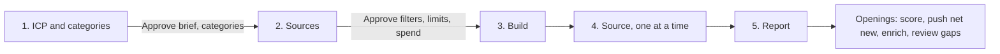

# TAM building, advanced

## The outcome

Your TAM as one account layer in Cargo, built the way no single data provider can: the same brief
given to four sources, every company they find merged into one account by Cargo itself, and a report
that says how much of the market you hold, how much of it is already in your CRM, and how much no
source found.

`tam-building` is the single-source version (one AI Ark search, one model). This one is for the
question that comes after: **how much of my market do I actually have?**

Four parts, each with its own way of going wrong.

**One brief, four sources.** Sales Navigator is the census (every company LinkedIn files under your
filters, split under its 1,000-account cap). AI Ark finds lookalikes of the customers you name. Apollo
is a second census in a different database. Exa searches by meaning, which reaches companies filed
under industries nobody filters on. Industries, company size and countries are written into all four,
so they search the same market. A source missing one of them bills for the whole dimension.

**One account per company, merged by Cargo, not by a workflow.** Every source lands its rows in its
own model and declares how it identifies a company: Sales Navigator by the LinkedIn company id, AI
Ark and Apollo by the domain and the LinkedIn page, Exa by the domain. Cargo's account unification
merges them into Unify Accounts and normalises the keys itself. Then one play reads each account
once: a LinkedIn company enrich (from the LinkedIn page any source gave, else the domain) and a
classification, written as one profile row in `tam_companies`. That row carries the LinkedIn id, the
page, LinkedIn's domain and the account's own domain together and unifies back into the same account:
it is what joins the company Sales Navigator found to the same company AI Ark found. A company four sources found is enriched
once.

**Your categories, not the providers'.** Every company is classified from its own description into
the categories you set, ideally the values of your CRM's industry field. A provider's industry label
is never trusted: LinkedIn files plenty of SaaS companies under IT services, and plenty of agencies
under software. Nothing is deleted: a company outside the ICP stays with `status` and
`exclusion_reason`, so you can see what each source returned that was not your market.

**Net new, known, and missing.** Your CRM's companies already unify into the same accounts, so
"already in the CRM" costs nothing: it is an account that also holds a CRM row. Every account also
says which sources found it. The report then estimates the companies no source found from the Sales
Navigator × Apollo overlap, and gives your coverage as a floor.

## Example

> Build our TAM from Sales Navigator, AI Ark, Apollo and Exa for B2B software with 51 to 1,000 people in North America and Western Europe, and tell me how much is net new.

Illustrative output, fictional records:

| TAM                                 | Companies |
| ----------------------------------- | --------- |
| In scope                            | 18,420    |
| Already in your CRM                 | 4,960     |
| Net new                             | 13,460    |
| Flagged out of scope (with reason)  | 21,305    |
| Needs review (thin page)            | 1,140     |

| Source          | Found  | Found by no other source | Added in this order |
| --------------- | ------ | ------------------------ | ------------------- |
| Sales Navigator | 16,210 | 9,380                    | 16,210              |
| AI Ark          | 5,640  | 910                      | +1,250              |
| Apollo          | 7,980  | 640                      | +730                |
| Exa             | 1,520  | 120                      | +230                |

Coverage: Sales Navigator × Apollo puts the market at 22,100 or more, so the 18,420 in scope are
about 83% of it at most. Top account: `northwind-analytics.example`, B2B SaaS, 340 people, found by
all four sources, net new.

## Guide the operator through every phase



Every substantive message starts with the current phase and ends with a `Next step` section giving the
operator one concrete decision, what it unlocks, and what stays blocked. During an in-progress
operation, say `No action needed` and name the next checkpoint. Never end with a generic offer to help.

1. **ICP and categories.** Read the context for an ICP. Settle industries, company size and countries,
   each quoted from `icp.md` or labelled a suggestion. Derive the categories from the CRM's company
   industry field, or from `icp.md`. Ask the operator to approve the brief and the categories.
2. **Sources.** Translate the brief into each source ([`references/configure.md`](references/configure.md)):
   Sales Navigator searches (split with `extract-sales-navigator-search` past 1,000 accounts), AI Ark
   groups and lookalike seeds counted for free, Apollo with a small first `limit`, Exa queries. Present
   each pool, each `limit`, the live prices and the estimate, including one LinkedIn enrich and one
   classification per distinct company. Ask for one approval of the filters, the limits and the maximum spend.
3. **Build.** Adapt, run `node --import tsx evals/contract.mjs`, check, plan, deploy.
4. **Source, one at a time.** Sales Navigator, then AI Ark, then Exa, then Apollo. Sync a source, let
   Accounts merge it, run the profile play once as a batch over its new accounts (five first, then the
   rest), then the next ([`references/run.md`](references/run.md)). The play is a build step: no
   schedule, never enabled.
5. **Report.** The headline (TAM, net new, already in the CRM), what each source added, what each
   returned that was not your market, the coverage estimate, actual credits against the estimate, and
   the openings.

## Put it in your project

This folder is a **worked example**: real project resources written for some other company. The job is
to end up with the code your company would have written, in your project, and an agent does the
adapting.

**Install the required authoring skill first.** If `cargo-project` is absent, run:

```sh
npx skills add getcargohq/cargo-skills --skill cargo-project
```

Then read `.agents/skills/cargo-project/SKILL.md` directly; no session reload is needed. Complete its
bootstrap and use its authoring, state, plan, and deployment rules throughout. Stop before any research
or template work if the skill cannot be installed or read.

1. **Install it: the CLI does the copy.** From inside the project (the folder holding `cargo.json`),
   `cargo-ai project add cookbook/tam-building-advanced` writes this example to
   `infra/tam-building-advanced/` and this procedure to `.agents/skills/tam-building-advanced/`. No
   project yet? `cargo-ai project init <dir> --cookbook tam-building-advanced && cd <dir> && npm install`
   does both; this folder never ships a shell. **If you are reading this from the project's
   `.claude/skills/`, the install already happened: start at step 2.** On a CLI too old to have
   `add`, copy this folder in as a sibling of what is there by hand; everything below is unchanged.
2. **Reconcile it with what is already declared.** If the project already has any of the five
   connectors, an `accounts` declaration (Unify Accounts, from `readiness-scoring` or
   `account-scoring`) or these folders, rewire the imports to the existing ones and drop the copies:
   two resources with one slug collide at deploy. Check that the workspace has Unify Accounts
   (`cargo-ai storage model list`, extractor `unifyAccounts`) and that the CRM's companies model
   unifies into it ([`references/configure.md`](references/configure.md)). If `tam-building` is
   installed, rename this skill's `tam_companies` before deploying: the two slugs collide.
   This skill declares no `defineContext`. This folder needs nothing in `.env`; append nothing and
   never overwrite it.
3. **Write or confirm the ICP, the three criteria and the categories.** Follow
   [`references/configure.md`](references/configure.md) sections 1 and 2, and stop for approval.
4. **Translate the brief into the four sources and size them.** Same file, sections 3 and 4. Stop for
   approval of the filters, the four limits and the spend. Do not deploy, sync or bill anything while
   that approval is pending.
5. **Adapt and deploy.** Work the sections below in order: _What should not change_ is what you argue
   back about (say what breaks, then do it if they still want it); _What you can change_ is what you
   offer unprompted (nobody asks for a variant they do not know exists); _What you will be asked_ is
   the floor, and you derive before you ask. If you are asking more than about four questions you have
   skipped lookups. Record what you changed and why under a `## Decisions` section in your copy of this
   file. Then run `node --import tsx evals/contract.mjs` from this skill's folder, followed by
   `cargo-ai project types && cargo-ai project check && cargo-ai project plan` from the project root.
   Show the diff and deploy. Never run `cargo-ai project init --force` in a non-empty directory.
6. **Source and report.** Follow [`references/run.md`](references/run.md): one source at a time, the profile
   batch piloted on five accounts before the rest, then the report queries, and walk _Done when_ line by line with evidence. Deployed
   cleanly and produced nothing is the normal failure.

## What you will be asked

**Derive before you ask.** An input with a lookup is looked up, not asked. Only the approvals genuinely
live in the operator's head.

| Input                     | Kind    | How it is answered                                                                                                                                              | Why it matters                                                                                                    |
| ------------------------- | ------- | --------------------------------------------------------------------------------------------------------------------------------------------------------------- | ----------------------------------------------------------------------------------------------------------------- |
| `icp`                     | derived | The workspace context first (`icp.md`, a scoring rubric). None? `tam-building`'s research step, after its prices are approved                                   | Four source filters and the classifier answer to it. If they answer to four different readings, the TAM is four markets |
| `market_minimum`          | derived | Industries, company size and countries, quoted from `icp.md` or labelled a suggestion, confirmed once and written into all four sources and `settings.ts`        | A source missing one bills for the whole dimension, and the sources stop searching the same market               |
| `categories`              | derived | The CRM's company industry field when a CRM is connected (read the property's options), else the categories section of `icp.md`                                 | They are what every company is classified into. Your CRM's values make the TAM and the CRM speak one language     |
| `sales_navigator_searches`| derived | Build the search from the three criteria and count it. Over 1,000 accounts: `extract-sales-navigator-search` splits it and returns the URLs                     | One search serves at most 1,000 accounts; past that the rest of the market is silently not there                  |
| `lookalike_seeds`         | derived | Up to five customers: the ones the context names, or the CRM's closed-won companies                                                                            | AI Ark's lookalikes are only as good as the seeds; a guessed customer is not evidence                              |
| `exa_queries`             | derived | One per category and country, in the words a buyer would use, in `exaQueries` (`settings.ts`)                                                                  | Exa reaches companies filed under labels nobody filters on, but only for what the queries describe                |
| `crm`                     | derived | The CRM companies model that unifies into Unify Accounts (`cargo-ai storage model list`, then its key in an account's `ids`). None: every company is net new | It decides what "net new" is measured against                                                                      |
| `limits`                  | derived | From each source's count or a small sample pull, as a fraction of the pool for the first run                                                                    | Every paid source bills per returned record: the limits are the invoice                                            |

The two approvals (the brief with its categories, then filters plus limits plus spend) are decisions,
not inputs: they are asked every time.

Checked before moving on, not after the deploy:

- `market_minimum`: the same three criteria appear in every source's config and in `settings.ts`
- `categories`: the in-scope list, the out-of-scope list and "Not enough information" are all present
- `sales_navigator_searches`: every URL is under 1,000 accounts and carries `INDUSTRY`,
  `COMPANY_HEADCOUNT` and `REGION`
- `limits`: each one was shown against its pool with a live price

## What you can change

The code is a worked example. These reshapes are expected, and the agent offers them rather than
waiting to be asked. Every one costs something; that is what makes it a variation and not the default.

| Variation        | When it is right                                                                                     | How                                                                                                                                                                                                       | What it costs                                                                                                                                                       |
| ---------------- | ---------------------------------------------------------------------------------------------------- | --------------------------------------------------------------------------------------------------------------------------------------------------------------------------------------------------------- | ------------------------------------------------------------------------------------------------------------------------------------------------------------------- |
| `apollo-as-fallback` | Budget: three sources are enough until the report shows a gap                                      | Leave `tam_source_apollo` out of the first deploy and add it when the per-source table says Sales Navigator, AI Ark and Exa missed accounts you expected                                                  | No Sales Navigator × Apollo pair, so no coverage estimate unless a `reference-list` replaces it                                                                     |
| `reference-list` | You hold an independent list of the same market: a Crunchbase export, an earlier TAM, a list built another way | Load it as a model (Google Sheets or CSV) that unifies as an account on its domain or LinkedIn page, and pair it with Sales Navigator in the coverage query instead of Apollo                         | One more source to profile. The estimate gets better the more independent the list is; a list built from the same providers adds nothing                            |
| `drop-a-source`  | Budget, or a source that adds almost nothing in your market                                          | Remove its connector, its model and its line in the play's filter, and its entries in the contract, in one change                                                                                       | Coverage. Dropping Apollo also removes the census pair the estimate is computed from; pair Sales Navigator with AI Ark and say the estimate is weaker                |
| `growth-signal`  | Growth decides priority in your market                                                               | Add `salesNavigator.findCompanyInsights` after the LinkedIn enrich in the profile play, and a growth column on `tam_companies`                                                                            | One more paid call per company. Keep growth as information, never as a gate: a company that is not growing is still in your market                                 |
| `refresh`        | The market moves and the TAM goes stale. Every three to four months is enough                        | By hand: re-count and re-sync the sources in the same order, and run the profile batch after each. Or on its own: `schedule: { type: "cron", cron: "0 6 1 */3 *" }` on each paid source (the 1st of every third month), and `"0 6 2 */3 *"` with `isEnabled: true` on the profile play, the day after. A new company becomes a new account and is profiled; a known one is merged and costs nothing more | Every re-sync re-bills every returned record, including the companies already in the TAM: four times a year at most, and the contract refuses anything more frequent. Re-count Sales Navigator first: a split search drifts over a quarter |
| `fifth-source`   | A source that is good at your market (FullEnrich, free per record)                                   | One more source model with a declared account unification, one more line in the play's filter, and the contract's connector list edited                                                                | Nothing else: Cargo merges it, and the play profiles only the companies it adds                                                                                      |

## What should not change

However far you adapt, these hold. Ask for one anyway and the agent tells you what breaks, then does it if
you still want it, and records why under `## Decisions` in your copy of this file.

- **Cargo merges; no workflow writes the TAM.** (`unification` on every model in `infra/models/`) Unify
  Accounts is the TAM. A play that dedups sources into its own table re-implements key normalisation,
  misses the merges Cargo makes across three rows, and leaves two account layers that disagree.
- **Every unification is declared.** Sales Navigator's default unification is off: leave it undeclared
  and the census never reaches Accounts. The others are declared too, so a provider changing its
  default cannot move your TAM.
- **One profile per company, after the merge.** (`infra/plays/profile-company.ts`) The LinkedIn enrich
  and the classification run on the account, so a company four sources found is paid for once, and
  the profile row is what joins the Sales Navigator row to the others.
- **The profile matches on both domains.** (`infra/models/tam-companies.ts`) LinkedIn's domain and the
  account's own often differ (`corporate.acme.example` against `acme.example`). Match on LinkedIn's
  only and the profile becomes an account of its own while the source account stays unprofiled. Both
  keys go through a computed column that turns an empty value into null: an empty string is a key,
  and every row sharing it would merge.
- **A company's domain comes from evidence, never from a short link.** (`infra/scripts/company-domain.ts`)
  LinkedIn's domain when it is real, else the account's, else where LinkedIn's short link lands. A
  `bit.ly` or `hubs.ly` host written as a domain is a key shared by unrelated companies, and Cargo
  merges them into one account.
- **Companies are classified from their own description into your categories.**
  (`infra/plays/profile-company.ts`, `infra/settings.ts`) Trust a provider's industry label and services
  firms land in the TAM while real software companies filed elsewhere are dropped.
- **Nothing is deleted; everything out of scope carries its reason.** (`status` and `exclusion_reason`,
  computed on `tam_companies`) Delete instead and the report can no longer say what each source returned
  that was not your market, or why a company you expected is missing.
- **Nothing else is declared on Unify Accounts.** (`infra/models/accounts.ts`) A declared column list or
  schedule replaces the live one, and every pipeline and person in the workspace reads that model.
- **Unknown stays unknown.** A thin page, or a missing headcount or country, is `needs_review`, never
  out of scope. A provider that returns nothing has a coverage gap; it is not evidence about the company.
- **Sources run one after another.** (`references/run.md`) Profile one source's accounts before the next
  syncs: the next source's rows then merge onto accounts that already have a profile, and only the
  companies it adds are paid for.
- **The three criteria are in every source.** (`infra/models/tam-source-*.ts`) A source without
  industries, size or countries bills for the whole dimension and searches a different market than the
  others.
- **A paid source is built once, refreshed at most quarterly.** A sync re-bills every returned record,
  including the companies already in the TAM. No schedule by default; the `refresh` variation's
  quarterly cron is the most frequent the contract accepts.
- **Sales Navigator runs without a seat.** No `identityIds`: a search through someone's own account puts
  that account at risk.
- **Nothing is written to the CRM.** Pushing the net new is a separate write the operator approves, with
  a reviewed sample first.

## Done when

- the ICP came from the context or was researched and approved, and the three criteria are in all four
  sources and `settings.ts`
- the categories came from the CRM's industry field or `icp.md`, and every row of `tam_companies` carries
  one of them
- every Sales Navigator URL is under 1,000 accounts and carries `INDUSTRY`, `COMPANY_HEADCOUNT` and
  `REGION`
- the sources were synced and profiled one at a time, in order, each piloted on five accounts first
- every account a TAM source found has one profile with a LinkedIn company id and a status, no LinkedIn
  company id sits on two accounts, and every account holding two LinkedIn ids was read
- the report gives the TAM, net new and already in the CRM, the per-source table, the coverage estimate
  (or why it is too thin), and actual credits against the estimate
- nothing was written to the CRM
- `node --import tsx evals/contract.mjs` passes against the adapted resources

## What it costs

Read this before pointing the skill at a market-sized brief.

**Counting is free on AI Ark** and a fixed fee per search on Sales Navigator. Count every candidate
before anything syncs.

**Sourcing bills per returned record** on Sales Navigator, AI Ark and Apollo, and per returned result on
Exa. Each source's `limit` (or the number of queries times `exaResultsPerQuery`) is its invoice.

**Enrichment bills once per company, not per source.** Cargo merges the sources before the play runs,
so a company four sources found is one account and one profile: one LinkedIn enrich and one
classification. Estimate them on the expected number of distinct companies, which is well under the
sum of the sources. The merge itself is free.

Fetch every live price immediately before the approval with `cargo-ai connection integration get` for
`salesNavigator`, `aiArk`, `apolloio`, `exa` and `linkedin`, and record the lookup time. No price is
written in this skill on purpose: they change.

The sources carry **no schedule**. See `refresh` above for what a re-sync really costs.

## Composes into

`account-scoring` tiers the in-scope companies of `tam_companies` against the same ICP; compare the tiers by
number of sources, the companies several sources agree on tend to score higher. Pushing the net new
into the CRM is the usual next write, approved on its own; `crm-enrichment` and `crm-deduplication`
keep those records clean once they are there. `extract-sales-navigator-search` is the step that
splits a large Sales Navigator search, and `tam-building` is the single-source version of this skill.
