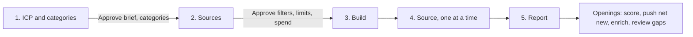

# TAM building, advanced

## The outcome

Your TAM as one model in Cargo, built the way no single data provider can: the same brief given to
four sources, every company they find merged on its LinkedIn company id, and a report that says how
much of the market you hold, how much of it is already in your CRM, and how much no source found.

`tam-building` is the single-source version (one AI Ark search, one model). This one is for the
question that comes after: **how much of my market do I actually have?**

Four parts, each with its own way of going wrong.

**One brief, four sources.** Sales Navigator is the census (every company LinkedIn files under your
filters, split under its 1,000-account cap). AI Ark finds lookalikes of the customers you name. Apollo
is a second census in a different database. Exa searches by meaning, which reaches companies filed
under industries nobody filters on. Industries, company size and countries are written into all four,
so they search the same market. A source missing one of them bills for the whole dimension.

**One door into the TAM.** Every source play calls the same tool. It recognises a company the TAM
already holds before it pays for anything, resolves a new one to its LinkedIn page, reads it from
there, and writes it with the same columns whatever source found it. The key is the LinkedIn company
id: websites redirect and names collide.

**Your categories, not the providers'.** Every company is classified from its own description into
the categories you set, ideally the values of your CRM's industry field. A provider's industry label
is never trusted: LinkedIn files plenty of SaaS companies under IT services, and plenty of agencies
under software. Nothing is deleted: a company outside the ICP stays with `status` and
`exclusion_reason`, so you can see what each source returned that was not your market.

**Net new, known, and missing.** Each company is looked up in your accounts and marked `in_crm` or
net new. The report then estimates the companies no source found from the Sales Navigator × Apollo
overlap, and gives your coverage as a floor.

## Example

> Build our TAM from Sales Navigator, AI Ark, Apollo and Exa for B2B software with 51 to 1,000 people in North America and Western Europe, and tell me how much is net new.

Illustrative output, fictional records:

| TAM                                 | Companies |
| ----------------------------------- | --------- |
| In scope                            | 18,420    |
| Already in your CRM                 | 4,960     |
| Net new                             | 13,460    |
| Flagged out of scope (with reason)  | 21,305    |
| Needs review (thin page)            | 1,140     |

| Source          | Found  | Found by no other source | Added in this order |
| --------------- | ------ | ------------------------ | ------------------- |
| Sales Navigator | 16,210 | 9,380                    | 16,210              |
| AI Ark          | 5,640  | 910                      | +1,250              |
| Apollo          | 7,980  | 640                      | +730                |
| Exa             | 1,520  | 120                      | +230                |

Coverage: Sales Navigator × Apollo puts the market at 22,100 or more, so the 18,420 in scope are
about 83% of it at most. Top account in `tam_universe`: `northwind-analytics.example`, B2B SaaS, 340
people, found by all four sources, net new.

## Guide the operator through every phase



Every substantive message starts with the current phase and ends with a `Next step` section giving the
operator one concrete decision, what it unlocks, and what stays blocked. During an in-progress
operation, say `No action needed` and name the next checkpoint. Never end with a generic offer to help.

1. **ICP and categories.** Read the context for an ICP. Settle industries, company size and countries,
   each quoted from `icp.md` or labelled a suggestion. Derive the categories from the CRM's company
   industry field, or from `icp.md`. Ask the operator to approve the brief and the categories.
2. **Sources.** Translate the brief into each source ([`references/configure.md`](references/configure.md)):
   Sales Navigator searches (split with `extract-sales-navigator-search` past 1,000 accounts), AI Ark
   groups and lookalike seeds counted for free, Apollo with a small first `limit`, Exa queries. Present
   each pool, each `limit`, the live prices and the estimate, including one LinkedIn lookup per new
   company. Ask for one approval of the filters, the limits and the maximum spend.
3. **Build.** Adapt, run `node --import tsx evals/contract.mjs`, check, plan, deploy.
4. **Source, one at a time.** Sales Navigator, then AI Ark, then Apollo, then Exa. Sync a source, pilot
   five rows, enable its play, wait until it is done, then the next ([`references/run.md`](references/run.md)).
5. **Report.** The headline (TAM, net new, already in the CRM), what each source added, what each
   returned that was not your market, the coverage estimate, actual credits against the estimate, and
   the openings.

## Put it in your project

This folder is a **worked example**: real project resources written for some other company. The job is
to end up with the code your company would have written, in your project, and an agent does the
adapting.

**Install the required authoring skill first.** If `cargo-project` is absent, run:

```sh
npx skills add getcargohq/cargo-skills --skill cargo-project
```

Then read `.agents/skills/cargo-project/SKILL.md` directly; no session reload is needed. Complete its
bootstrap and use its authoring, state, plan, and deployment rules throughout. Stop before any research
or template work if the skill cannot be installed or read.

1. **Install it: the CLI does the copy.** From inside the project (the folder holding `cargo.json`),
   `cargo-ai project add cookbook/tam-building-advanced` writes this example to
   `infra/tam-building-advanced/` and this procedure to `.agents/skills/tam-building-advanced/`. No
   project yet? `cargo-ai project init <dir> --cookbook tam-building-advanced && cd <dir> && npm install`
   does both; this folder never ships a shell. **If you are reading this from the project's
   `.claude/skills/`, the install already happened: start at step 2.** On a CLI too old to have
   `add`, copy this folder in as a sibling of what is there by hand; everything below is unchanged.
2. **Reconcile it with what is already declared.** If the project already has any of the five
   connectors, a `gtm_accounts` model, a CRM companies model or these folders, rewire the imports to
   the existing ones and drop the copies: two resources with one slug collide at deploy. An existing
   `gtm_accounts` is imported together with the folder it already sits in, or the deploy moves it
   ([`references/configure.md`](references/configure.md)). If
   `tam-building` is installed, its `tam_companies` stays; this skill's AI Ark source is its own model.
   This skill declares no `defineContext`. This folder needs nothing in `.env`; append nothing and
   never overwrite it.
3. **Write or confirm the ICP, the three criteria and the categories.** Follow
   [`references/configure.md`](references/configure.md) sections 1 and 2, and stop for approval.
4. **Translate the brief into the four sources and size them.** Same file, sections 3 and 4. Stop for
   approval of the filters, the four limits and the spend. Do not deploy, sync or bill anything while
   that approval is pending.
5. **Adapt and deploy.** Work the sections below in order: _What should not change_ is what you argue
   back about (say what breaks, then do it if they still want it); _What you can change_ is what you
   offer unprompted (nobody asks for a variant they do not know exists); _What you will be asked_ is
   the floor, and you derive before you ask. If you are asking more than about four questions you have
   skipped lookups. Record what you changed and why under a `## Decisions` section in your copy of this
   file. Then run `node --import tsx evals/contract.mjs` from this skill's folder, followed by
   `cargo-ai project types && cargo-ai project check && cargo-ai project plan` from the project root.
   Show the diff and deploy. Never run `cargo-ai project init --force` in a non-empty directory.
6. **Source and report.** Follow [`references/run.md`](references/run.md): one source at a time, pilot
   before enabling, then the report queries, and walk _Done when_ line by line with evidence. Deployed
   cleanly and produced nothing is the normal failure.

## What you will be asked

**Derive before you ask.** An input with a lookup is looked up, not asked. Only the approvals genuinely
live in the operator's head.

| Input                     | Kind    | How it is answered                                                                                                                                              | Why it matters                                                                                                    |
| ------------------------- | ------- | --------------------------------------------------------------------------------------------------------------------------------------------------------------- | ----------------------------------------------------------------------------------------------------------------- |
| `icp`                     | derived | The workspace context first (`icp.md`, a scoring rubric). None? `tam-building`'s research step, after its prices are approved                                   | Four source filters and the classifier answer to it. If they answer to four different readings, the TAM is four markets |
| `market_minimum`          | derived | Industries, company size and countries, quoted from `icp.md` or labelled a suggestion, confirmed once and written into all four sources and `settings.ts`        | A source missing one bills for the whole dimension, and the sources stop searching the same market               |
| `categories`              | derived | The CRM's company industry field when a CRM is connected (read the property's options), else the categories section of `icp.md`                                 | They are what every company is classified into. Your CRM's values make the TAM and the CRM speak one language     |
| `sales_navigator_searches`| derived | Build the search from the three criteria and count it. Over 1,000 accounts: `extract-sales-navigator-search` splits it and returns the URLs                     | One search serves at most 1,000 accounts; past that the rest of the market is silently not there                  |
| `lookalike_seeds`         | derived | Up to five customers: the ones the context names, or the CRM's closed-won companies                                                                            | AI Ark's lookalikes are only as good as the seeds; a guessed customer is not evidence                              |
| `exa_queries`             | derived | One per category and country, in the words a buyer would use                                                                                                    | Exa reaches companies filed under labels nobody filters on, but only for what the queries describe                |
| `crm`                     | derived | Which CRM connector is authenticated (`cargo-ai connection connector list`). None: the shared `gtm_accounts` model                                              | It decides what "net new" is measured against                                                                      |
| `limits`                  | derived | From each source's count or a small sample pull, as a fraction of the pool for the first run                                                                    | Every paid source bills per returned record: the limits are the invoice                                            |

The two approvals (the brief with its categories, then filters plus limits plus spend) are decisions,
not inputs: they are asked every time.

Checked before moving on, not after the deploy:

- `market_minimum`: the same three criteria appear in every source's config and in `settings.ts`
- `categories`: the in-scope list, the out-of-scope list and "Not enough information" are all present
- `sales_navigator_searches`: every URL is under 1,000 accounts and carries `INDUSTRY`,
  `COMPANY_HEADCOUNT` and `REGION`
- `limits`: each one was shown against its pool with a live price

## What you can change

The code is a worked example. These reshapes are expected, and the agent offers them rather than
waiting to be asked. Every one costs something; that is what makes it a variation and not the default.

| Variation        | When it is right                                                                                     | How                                                                                                                                                                                                       | What it costs                                                                                                                                                       |
| ---------------- | ---------------------------------------------------------------------------------------------------- | --------------------------------------------------------------------------------------------------------------------------------------------------------------------------------------------------------- | ------------------------------------------------------------------------------------------------------------------------------------------------------------------- |
| `crm-backed`     | Your companies live in HubSpot or Salesforce, which is most workspaces                               | Replace `gtm_accounts` with a CRM companies model (`fetchRecords`, every column, no config filter) and point the CRM lookup in `infra/tools/write-company.ts` at its domain property (`domain` on HubSpot, your bare-domain field on Salesforce, never `Website`) | A CRM connector to authenticate, and the extract to keep fresh. The pipeline still writes nothing to the CRM                                                          |
| `reference-list` | You hold an independent list of the same market: a Crunchbase export, an earlier TAM, a list built another way | Load it as a model (Google Sheets or CSV), add a `found_by_reference` flag, and pair it with the TAM in the coverage query instead of Apollo                                                 | One more source to resolve to LinkedIn. The estimate gets better the more independent the list is; a list built from the same providers adds nothing                 |
| `drop-a-source`  | Budget, or a source that adds almost nothing in your market                                          | Remove its connector, model and play, and its entry in the contract's connector list, in one change                                                                                                     | Coverage. Dropping Apollo also removes the census pair the estimate is computed from; pair Sales Navigator with AI Ark and say the estimate is weaker                |
| `growth-signal`  | Growth decides priority in your market                                                               | Add `salesNavigator.findCompanyInsights` after the LinkedIn lookup in `tam_unify_company`, and a growth column on `tam_universe`                                                                           | One more paid call per new company. Keep growth as information, never as a gate: a company that is not growing is still in your market                              |
| `refresh`        | The market moves and the TAM goes stale                                                              | Re-count and re-sync the sources in the same order. New companies flow through the plays; known ones only get their `last_seen_at`                                                                       | Every re-sync re-bills every returned record, including the companies already in the TAM. Re-count Sales Navigator first: counts drift week to week                   |
| `fifth-source`   | A source that is good at your market (FullEnrich, free per record)                                   | One more source model and play, the same shape as AI Ark's, a `found_by_` column, and the contract's connector list edited                                                                                | One more resolution pass; on a free source, a scheduled refresh becomes possible                                                                                    |

## What should not change

However far you adapt, these hold. Ask for one anyway and the agent tells you what breaks, then does it if
you still want it, and records why under `## Decisions` in your copy of this file.

- **Every company is keyed on its LinkedIn company id.** (`infra/models/tam-universe.ts`,
  `infra/tools/write-company.ts`) Key on a domain or a name instead and the same company lands twice:
  once under its redirect, once under its old name, and every count in the report is wrong.
- **Every source goes through the same door.** (`infra/tools/unify-company.ts`) A source that writes
  into `tam_universe` on its own brings its own columns, and a row it found can no longer be compared
  with a row another source found.
- **Companies are classified from their own description into your categories.**
  (`infra/tools/write-company.ts`, `infra/settings.ts`) Trust a provider's industry label and services
  firms land in the TAM while real software companies filed elsewhere are dropped.
- **Nothing is deleted; everything out of scope carries its reason.** (`infra/scripts/judge-company.ts`)
  Delete instead and the report can no longer say what each source returned that was not your market,
  or why a company you expected is missing.
- **Unknown stays unknown.** A thin page, or a missing headcount or country, is `needs_review`, never
  out of scope. A provider that returns nothing has a coverage gap; it is not evidence about the company.
- **Sources run one after another.** (`references/run.md`) Run two at once and both miss each other's
  fresh rows: the same company is enriched twice and lands twice.
- **The three criteria are in every source.** (`infra/models/tam-source-*.ts`) A source without
  industries, size or countries bills for the whole dimension and searches a different market than the
  others.
- **A paid source carries no schedule.** A cron re-bills every returned record, including the companies
  already in the TAM.
- **Sales Navigator runs without a seat.** No `identityIds`: a search through someone's own account puts
  that account at risk.
- **Nothing is written to the CRM.** Pushing the net new is a separate write the operator approves, with
  a reviewed sample first.

## Done when

- the ICP came from the context or was researched and approved, and the three criteria are in all four
  sources and `settings.ts`
- the categories came from the CRM's industry field or `icp.md`, and every row of `tam_universe` carries
  one of them
- every Sales Navigator URL is under 1,000 accounts and carries `INDUSTRY`, `COMPANY_HEADCOUNT` and
  `REGION`
- the sources were synced and processed one at a time, in order, each piloted on five rows first
- every row of `tam_universe` has a LinkedIn company id, a status and at least one `found_by_*` flag, and
  no company appears twice
- the report gives the TAM, net new and already in the CRM, the per-source table, the coverage estimate
  (or why it is too thin), and actual credits against the estimate
- nothing was written to the CRM
- `node --import tsx evals/contract.mjs` passes against the adapted resources

## What it costs

Read this before pointing the skill at a market-sized brief.

**Counting is free on AI Ark** and a fixed fee per search on Sales Navigator. Count every candidate
before anything syncs.

**Sourcing bills per returned record** on Sales Navigator, AI Ark and Apollo, and per returned result on
Exa. Each source's `limit` (or the number of queries times `exaResultsPerQuery`) is its invoice.

**Enrichment bills once per new company, not per source.** The unify tool recognises a company the TAM
already holds before paying anything, so a company four sources found is resolved once. Every new
company costs one LinkedIn lookup and one classification. Estimate them on the expected number of
distinct companies, which is well under the sum of the sources.

Fetch every live price immediately before the approval with `cargo-ai connection integration get` for
`salesNavigator`, `aiArk`, `apolloio`, `exa` and `linkedin`, and record the lookup time. No price is
written in this skill on purpose: they change.

The sources carry **no schedule**. See `refresh` above for what a re-sync really costs.

## Composes into

`account-scoring` tiers the in-scope rows of `tam_universe` against the same ICP; compare the tiers by
number of sources, the companies several sources agree on tend to score higher. Pushing the net new
into the CRM is the usual next write, approved on its own; `crm-enrichment` and `crm-deduplication`
keep those records clean once they are there. `extract-sales-navigator-search` is the step that
splits a large Sales Navigator search, and `tam-building` is the single-source version of this skill.
